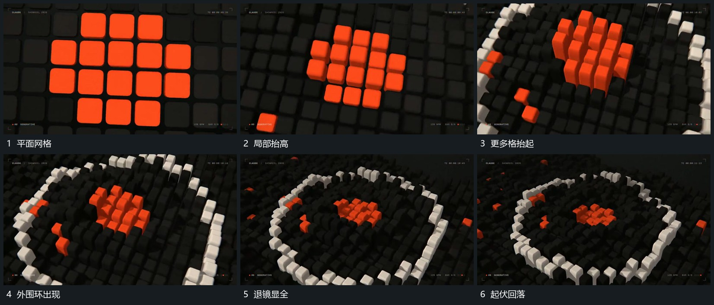

# 平面网格逐格抬起，退镜中外围接成圆环

## 运动指令

让平面网格中选定小格逐步抬高，形成高低变化；同时后退并改变观察角度，揭出外围小格组成的圆环。内格可再回落，外围环保持，最后缩回完整承载布局。

## 视频切片

[播放本机制的原片切片](m06.mp4)

覆盖分镜中“平面网格”至“起伏回落”的连续过程，并保留邻近的前后衔接画面；原片中交叠发生的动作一并保留。

## 分镜过程

## 组合与调整

只采用可见高低与退镜关系，不推定隐藏地形。内区与外环的建立需相互接续。
