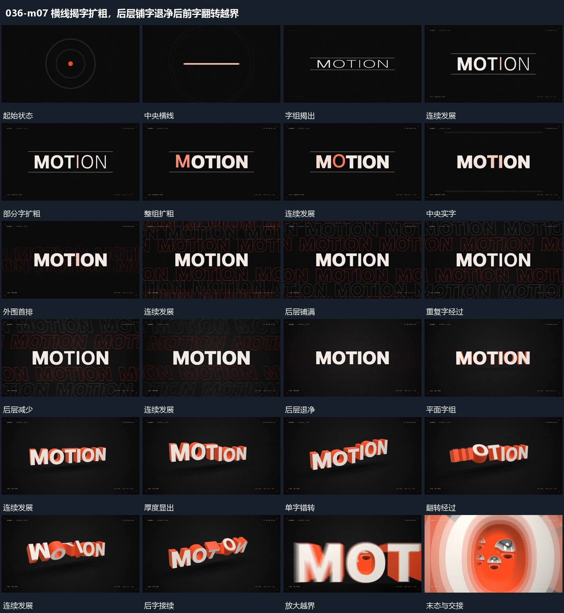

# 横线揭字扩粗，后层铺字退净后前字翻转越界

## 运动指令

横线拉开建立主字，主字扩粗时轮廓字在后层铺满；后层退净，主字错开翻转并前移越界结束。

1. **横线拉开上下边界，字组揭出后逐步扩粗**

让中央横线转成上下两条边界线，字组在两线之间揭出。文字完整后，字形从细到粗逐步变化，部分先变、后续再补齐，最终整组保持。

2. **中央实字保持，后层轮廓字铺满后退净**

保留中央实字，在后层加入重复轮廓字，逐排铺开到画面边缘。让后层重复字继续经过，再逐步退去；中央字全程稳定，形成主形保持与外围活动的区别。

3. **单字错开翻转带出厚度，整组前移放大越界**

先让字组显出可见厚度，各单字错开翻转，前后字姿态不完全同步。局部翻转形成活动后，整组向前放大并越过画面边缘，接入下一段。

整段结束：字组放大越过边缘 保留必要落稳与交接，中间已建立的参照沿用到下一步骤。

## 视频切片

[播放本机制的原片切片](m07.mp4)

保留起始准备、连续发展和完成或明确交接；首尾按本段运动范围裁切，不拼接、不变速。相连的小动作合为同一完整段落。

## 分镜过程

## 组合与调整

横线拉开建立主字，主字扩粗时轮廓字在后层铺满；后层退净，主字错开翻转并前移越界结束。 复用时可调整元素数量、幅度和相对节奏，保留上述进入、交叠与完成关系；不直接沿用原片题材或时长。

可换字组，但保留从边界到内容的接续。字形变化需要可实现的字形或图形方案，不声称还原原作者方法。

后层数量可以减少，保持前层可读，不能让复制字覆盖主字到无法辨认。

新片可用图块替代单字。只规定可见转动与尺度，不推定原片三维模型或精确旋转轴。
