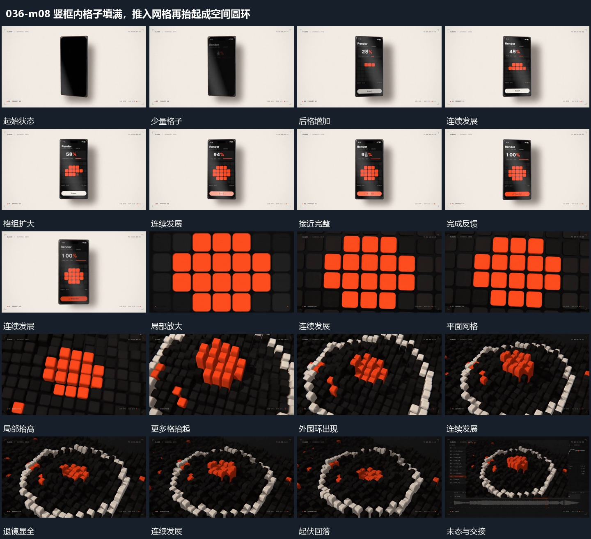

# 竖框内格子填满，推入网格再抬起成空间圆环

## 运动指令

竖框内数值与填格同步，完成后推入该网格；格子逐项抬起，退镜露出外围圆环并完成空间展开。

1. **固定竖框中格子分批填入，数值同步增加后局部放大**

在固定竖框内分批增加小格，已有格保留，旁侧数值随填充增加。达到完整格组后更换底部反馈条，再把视线推入格组局部，使格子接管满幅。

2. **平面网格逐格抬起，退镜中外围接成圆环**

让平面网格中选定小格逐步抬高，形成高低变化；同时后退并改变观察角度，揭出外围小格组成的圆环。内格可再回落，外围环保持，最后缩回完整承载布局。

整段结束：起伏小格与外围环齐全 保留必要落稳与交接，中间已建立的参照沿用到下一步骤。

## 视频切片

[播放本机制的原片切片](m08.mp4)

保留起始准备、连续发展和完成或明确交接；首尾按本段运动范围裁切，不拼接、不变速。相连的小动作合为同一完整段落。

## 分镜过程

## 组合与调整

竖框内数值与填格同步，完成后推入该网格；格子逐项抬起，退镜露出外围圆环并完成空间展开。 复用时可调整元素数量、幅度和相对节奏，保留上述进入、交叠与完成关系；不直接沿用原片题材或时长。

格子增长应有先后来源。数值和格数不必逐一对应，但完成反馈必须在组形完整后出现。

只采用可见高低与退镜关系，不推定隐藏地形。内区与外环的建立需相互接续。
