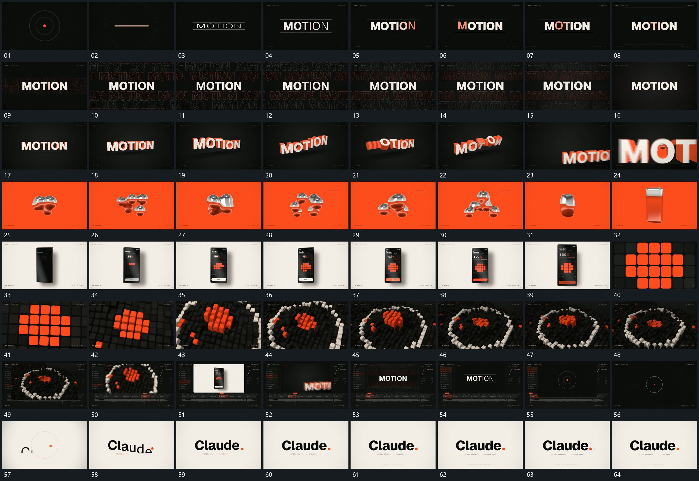

# 036｜原片运动总览

[观看完整原片](video.mp4)

## 运动总览

开头由点与环转为中央横线，横线拉开上下边界，字组揭出后逐步扩粗 在两条横线间揭出字组并让字形扩粗。中央实字保持，后层轮廓字铺满后退净 保留中央实字，后层重复轮廓字从少到多铺满，再退去。单字错开翻转带出厚度，整组前移放大越界 将字组带出厚度，单字错开翻转，整组放大越界。

中段 圆块群反复分合，收成竖形后拉长 让圆块群反复分合，最后收成竖形并拉长；新竖框接管。固定竖框中格子分批填入，数值同步增加后局部放大 在固定竖框内让小格分批填满，同时数值增加，完成后推入局部。平面网格逐格抬起，退镜中外围接成圆环 把网格小格逐步抬高并退镜，外围小格接成圆环。末段缩回完整布局，内部轮换到起始字组和点环，再建立收尾字组保持。

## 完整运动段落

以下按原片中的出现顺序引用。建立、内部发展及完成反馈放在同一段中；同时发生的局部动作与运镜写在同一份指令里。不同段之间可以是连续接管，也可以是直接切换，不能仅凭条目相邻认定可直接拼接。重复出现的同类运动采用一次连续代表范围，切片不以逐段无缝覆盖整片为目标。

1. [横线揭字扩粗，后层铺字退净后前字翻转越界](mechanisms/m07.md)：横线拉开建立主字，主字扩粗时轮廓字在后层铺满；后层退净，主字错开翻转并前移越界结束。

2. [圆块群反复分合，收成竖形后拉长](mechanisms/m04.md)：分开并拢交替，最后纵向延展

3. [竖框内格子填满，推入网格再抬起成空间圆环](mechanisms/m08.md)：竖框内数值与填格同步，完成后推入该网格；格子逐项抬起，退镜露出外围圆环并完成空间展开。

切片保留起始准备、必要内部停顿和完成或明确交接；首尾省略无新发展的等待，持续运动不要求人为停住。以上基于真实源帧序列和重点边界核对，不等同于全片连续声画审片。

## 完整64宫格

