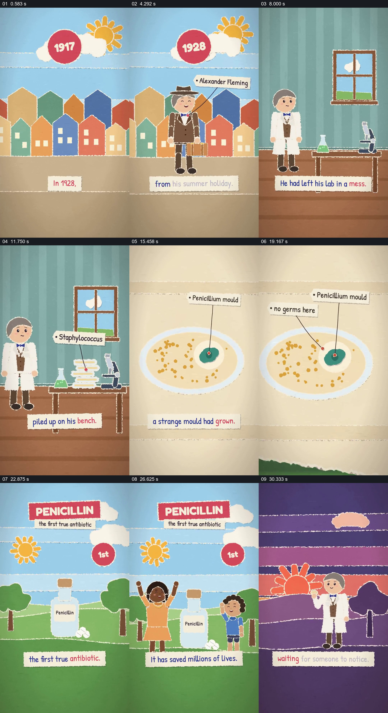

# 从实验室里的异常细节接到发现与后续影响

- 作品：案例 085《培养皿中的意外发现》（本次概括）。
- 原片范围：00:00.000–00:33.472，含起点、不含终点；[完整原片](../video.mp4)｜[本卡片段](../video.mp4)。
- 观察方式：依据约每秒一次的真实源帧观察，未连续原速观看或听审；声音、语气与完整播放节奏未确认。

## 原画面具体怎样设计

纸片拼贴式场景先以年份和姓名介绍弗莱明回到家，随后切到实验室，桌上堆起培养皿。画面靠近其中一只皿，标出霉菌，再用箭头指向周围没有细菌的区域；之后画面换成药瓶、青霉素标题及人物，字幕称其挽救很多生命，最后回到科学家并以“错误可能是等待被发现的发现”收束。

## 为什么这样设计，好在哪里

从人物与一堆培养皿缩到一个具体异常，再以标签区分霉菌和周围区域，让发现有可见对象；后面的药瓶将作品所讲的影响接回该观察。历史细节和影响数字为片中叙述，未在此独立核实。

以上为依据画面的分析，非作者自述；预期观看效果未经观众测试。

## 可直接使用的创意指令

讲述科学发现时，先交代人物与观察条件，选择能够展示关键异常的真实材料或明确标示的示意图，逐步指出异常与对照区域，再根据可靠来源说明后续研究和影响；保留观察与后来应用之间的时间及证据边界，不把视觉重演当作原始影像。
