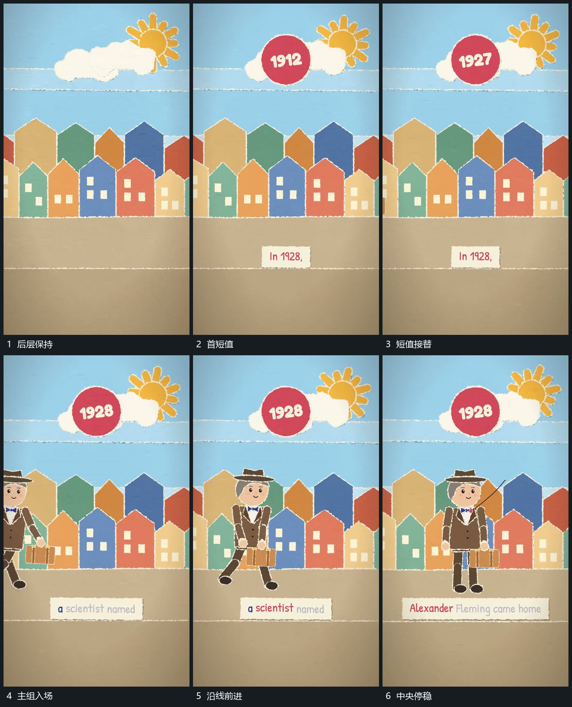

# 主组沿底线从侧边进入上方短值接替

## 运动指令

主组从侧边沿共同底线进入，内部小部件在前进中交替改变角度。上方小圆与后层保持，仅短值在同一位置接替。主组到中央后收回多余位移，再补旁侧指示短标。

## 视频切片

[播放本机制的原片切片](m01.mp4)

覆盖分镜中“后层保持”至“中央停稳”的连续过程，并保留邻近的前后衔接画面；原片中交叠发生的动作一并保留。

## 分镜过程

## 组合与调整

可替换主组形状；入场在底线连续运动，不把短值变化误当作主组跳转。
