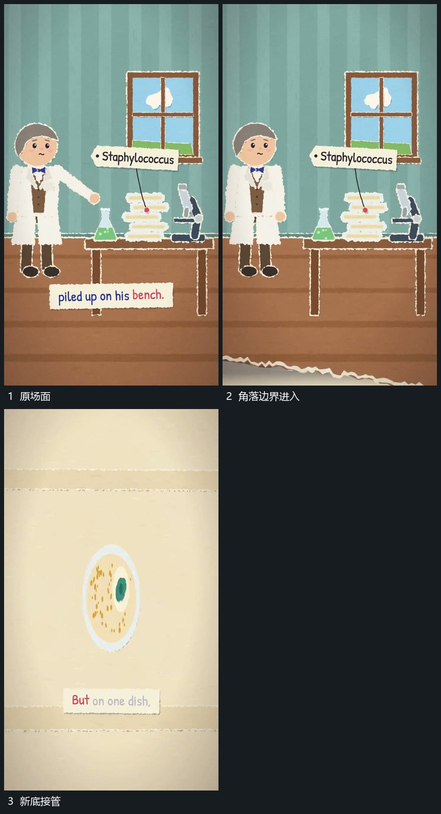

# 不规则片边从角落横斜推进并覆盖换底

## 运动指令

从画面角落推进一张大覆盖片，不规则边界沿斜向横过原场面。新底随片的范围逐步出现，旧层被按区域遮住，直到边界越出画面；下一主形在新底接管时进入。

## 视频切片

[播放本机制的原片切片](m03.mp4)

覆盖分镜中“原场面”至“新底接管”的连续过程，并保留邻近的前后衔接画面；原片中交叠发生的动作一并保留。

## 分镜过程

## 组合与调整

改变方向即可复用；完整边界始终连续，避免用多个小块同时闪现冒充覆盖。
