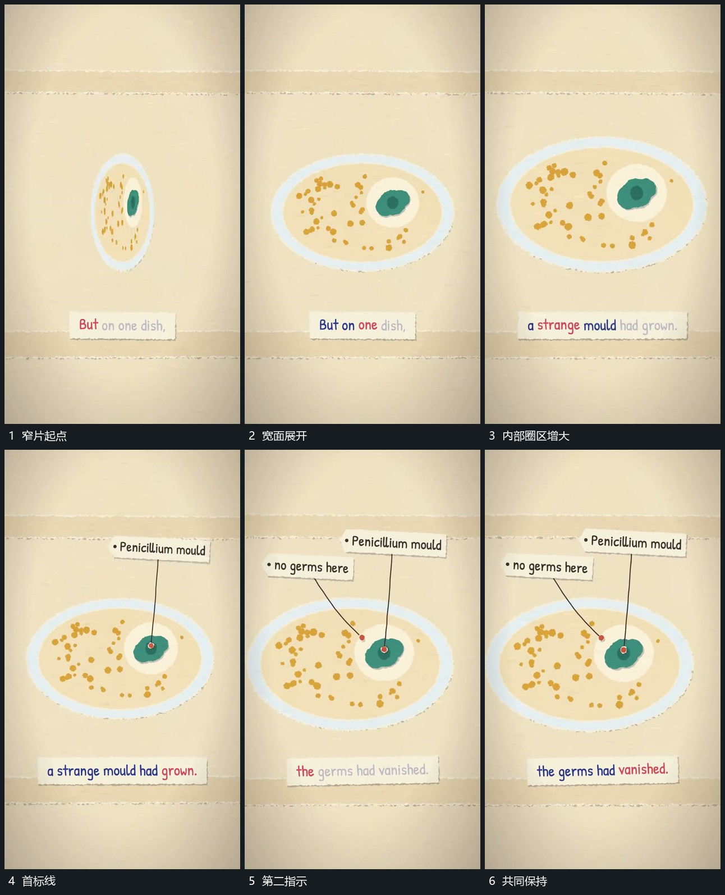

# 窄片转向展开为宽椭圆再补局部指示

## 运动指令

让窄片围自身中心转向，横向投影逐步变宽成为椭圆面，内部各点随片一起展开。稳定后圈出一个局部范围，从局部延长指示线并接短标；第二指示随后加入，前一指示保持。

## 视频切片

[播放本机制的原片切片](m04.mp4)

覆盖分镜中“窄片起点”至“共同保持”的连续过程，并保留邻近的前后衔接画面；原片中交叠发生的动作一并保留。

## 分镜过程

## 组合与调整

转向保持同一片面身份；局部范围扩大只作用于内部，不让外椭圆同步变大。
