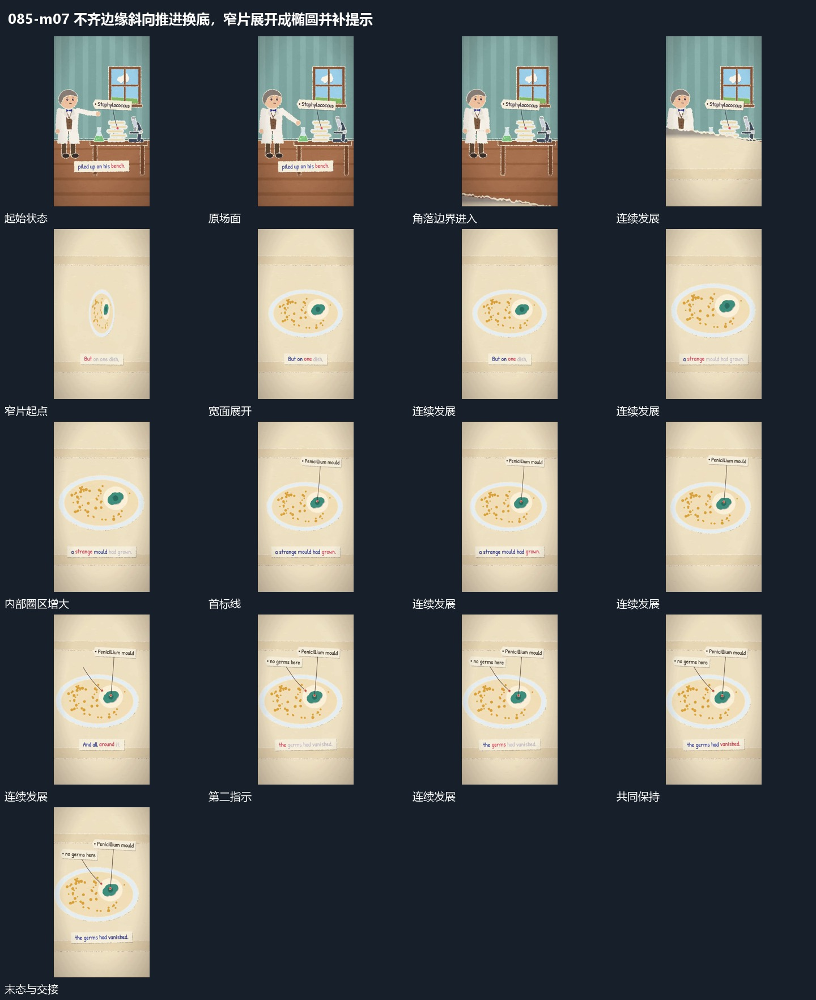

# 不齐边缘斜向推进换底，窄片展开成椭圆并补提示

## 运动指令

角落不规则片边斜向扩大覆盖，揭出新的窄片；窄片转向并展开为宽椭圆，局部引线和标注再补齐。

1. **不规则片边从角落横斜推进并覆盖换底**

从画面角落推进一张大覆盖片，不规则边界沿斜向横过原场面。新底随片的范围逐步出现，旧层被按区域遮住，直到边界越出画面；下一主形在新底接管时进入。

2. **窄片转向展开为宽椭圆再补局部指示**

让窄片围自身中心转向，横向投影逐步变宽成为椭圆面，内部各点随片一起展开。稳定后圈出一个局部范围，从局部延长指示线并接短标；第二指示随后加入，前一指示保持。

整段结束：宽椭圆内部有多个指示 保留必要落稳与交接，中间已建立的参照沿用到下一步骤。

## 视频切片

[播放本机制的原片切片](m07.mp4)

保留起始准备、连续发展和完成或明确交接；首尾按本段运动范围裁切，不拼接、不变速。相连的小动作合为同一完整段落。

## 分镜过程

## 组合与调整

角落不规则片边斜向扩大覆盖，揭出新的窄片；窄片转向并展开为宽椭圆，局部引线和标注再补齐。 复用时可调整元素数量、幅度和相对节奏，保留上述进入、交叠与完成关系；不直接沿用原片题材或时长。

改变方向即可复用；完整边界始终连续，避免用多个小块同时闪现冒充覆盖。

转向保持同一片面身份；局部范围扩大只作用于内部，不让外椭圆同步变大。
