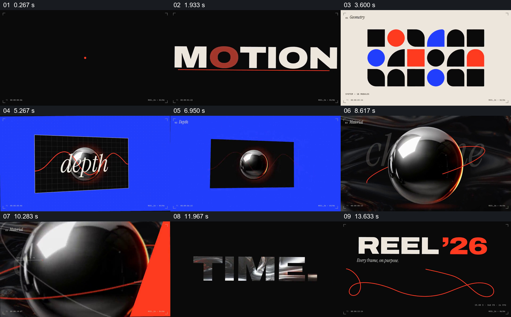

# 从平面几何走到空间与材质，再收束作品身份

- 作品：案例 116《几何、深度与材质的作品展示》（本次概括）。
- 原片范围：00:00.000–00:15.046，含起点、不含终点；[完整原片](../video.mp4)｜[本卡片段](../video.mp4)。
- 观察方式：依据约每秒一次的真实源帧观察，未连续原速观看或听审；声音、语气与完整播放节奏未确认。

## 原画面具体怎样设计

黑底上红线引出 MOTION 字样，浅底网格排列黑、红、蓝几何形状；蓝底中一张带文字的平面以透视角度出现，再切到反光金属球和环绕红线。随后 SPACE、TIME 等大字依次出现，最后黑底显示 REEL 字样与红色曲线。

## 为什么这样设计，好在哪里

平面图形、透视平面与反光球形成清楚的视觉层次变化；红线和有限的配色贯穿多个段落，保持它们属于同一个作品集。空间效果和动作细节仍需连续观察。

以上为依据画面的分析，非作者自述；预期观看效果未经观众测试。

## 可直接使用的创意指令

组织从平面到立体的作品展示时，先建立简单几何及统一色彩，再展示空间视角和可辨材质，保留一条共同线索连接不同画面；最后用作品名称收束。具体素材与运动按实际作品选择。
