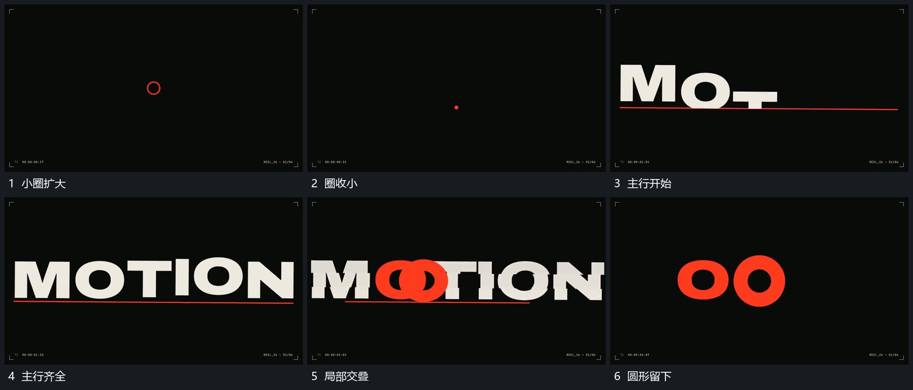

# 主行逐段建立局部圆形留下作为下一接点

## 运动指令

中央小圈收回后沿基线逐段建立主行，下线从一端延长。主行完成后让其中圆形局部向前突出，周围字片退让并退出，只留该圆形局部作为下一阶段接点。

## 视频切片

[播放本机制的原片切片](m01.mp4)

覆盖分镜中“小圈扩大”至“圆形留下”的连续过程，并保留邻近的前后衔接画面；原片中交叠发生的动作一并保留。

## 分镜过程

## 组合与调整

主行可换其他带圆部的图形；先建立完整来源，再释放局部。
