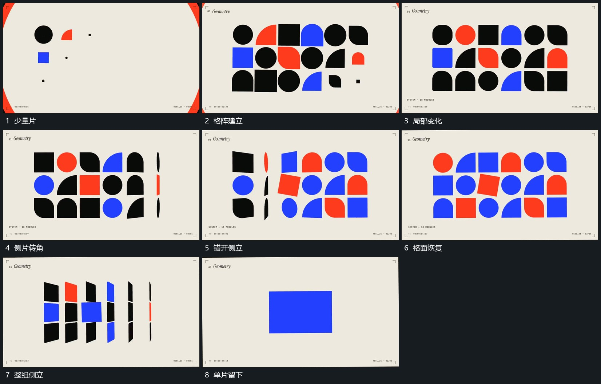

# 少量片扩成格阵各片错开转角最后侧立回收

## 运动指令

从少量片向周边补出格阵，每片保持自己的格位。不同列错开绕竖向转角，投影由宽变窄再展开；整组最后沿同一方向侧立，外围片逐步收回，只留下中央单片。

## 视频切片

[播放本机制的原片切片](m02.mp4)

覆盖分镜中“少量片”至“单片留下”的连续过程，并保留邻近的前后衔接画面；原片中交叠发生的动作一并保留。

## 分镜过程

## 组合与调整

形态变化按本片缩减，格位保持可辨；侧立与回收不能同步把所有片闪灭。
