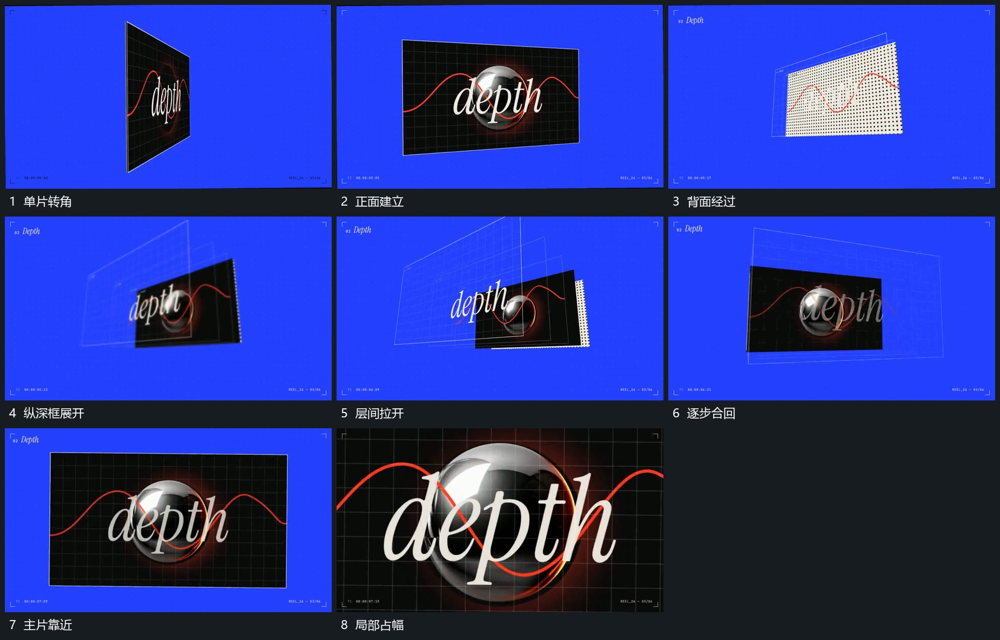

# 单片转角后多框沿纵深拉开再合回推近

## 运动指令

单片先转向可读正面，再沿深度方向拉开多层框，后框带不同距离与小倾角，前片内部保持。展开后后框逐步向前片靠拢并退去，取景同时靠近主片，最终内部范围占满画面。

## 视频切片

[播放本机制的原片切片](m03.mp4)

覆盖分镜中“单片转角”至“局部占幅”的连续过程，并保留邻近的前后衔接画面；原片中交叠发生的动作一并保留。

## 分镜过程

## 组合与调整

可只用几层框；分层保留前后次序，内部图层不随每次转角重新出现。
