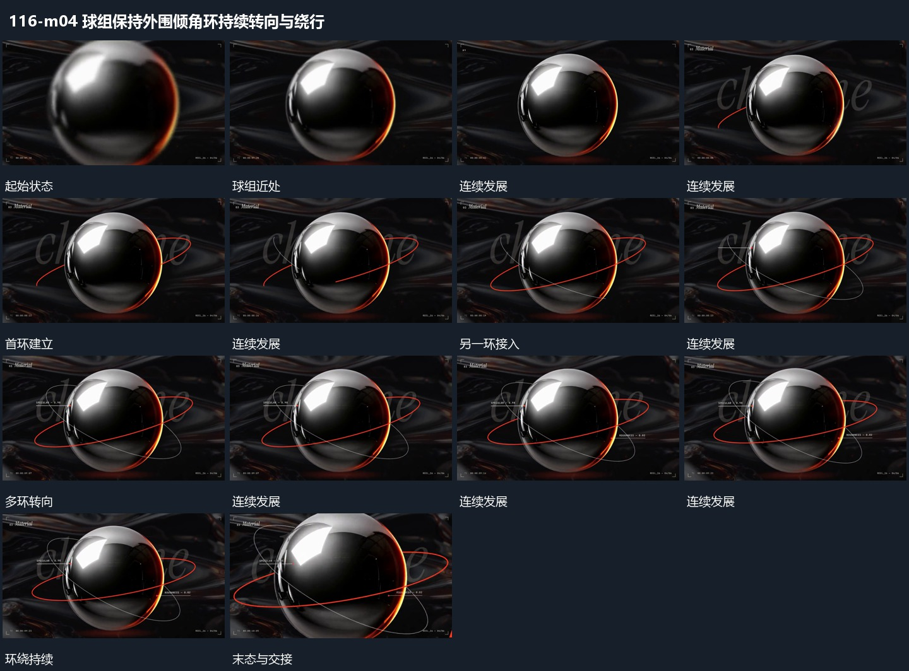

# 球组保持外围倾角环持续转向与绕行

## 运动指令

保留球组中心，外围环带不同倾角持续转向，近侧线从球前经过，远侧线被球部分遮挡。球组自身可少量转角，取景缓慢靠近；各环共享中心但不在同一平面锁定。

## 视频切片

[播放本机制的原片切片](m04.mp4)

保留起始准备、连续发展和完成或明确交接；首尾按本段运动范围裁切，不拼接、不变速。尾部只保留理解结果所需的展示。

## 分镜过程

## 组合与调整

无需继承材质，采用简单球和线即可；深度遮挡随环角度连续变化。
