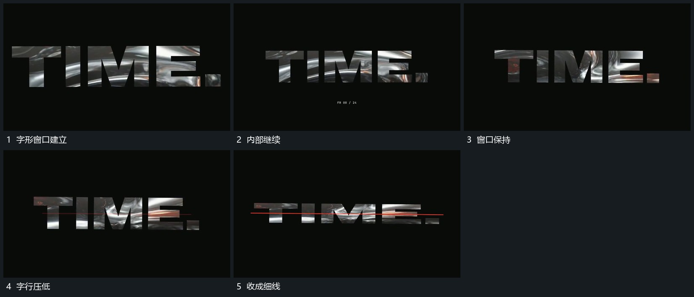

# 字形窗口内部图层持续经过外轮廓保持后压成细线

## 运动指令

用完整字形窗口接管原活动图层，字形外轮廓保持，内部图层继续横向或局部转向经过。完成后压低整行高度，上下边缘逐步收近，直到成为一条细线；内部层在收缩中退让。

## 视频切片

[播放本机制的原片切片](m05.mp4)

覆盖分镜中“字形窗口建立”至“收成细线”的连续过程，并保留邻近的前后衔接画面；原片中交叠发生的动作一并保留。

## 分镜过程

## 组合与调整

窗口可换其他轮廓；外边界与内部运动分开，不把字形随内部画面一起漂走。
