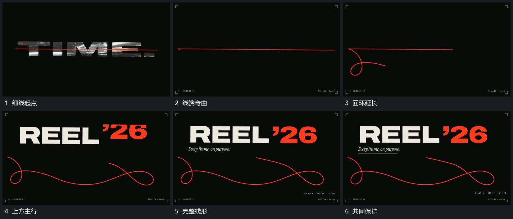

# 细线沿路径延长弯成回环主行随后建立

## 运动指令

保留细线的一端，另一端沿弯曲路线前进，身后线逐步延长并形成回环。线形可辨后在上方分段建立主行，下方线仍缓慢改变局部弯曲；附属短行最后接入，共同保持。

## 视频切片

[播放本机制的原片切片](m06.mp4)

覆盖分镜中“细线起点”至“共同保持”的连续过程，并保留邻近的前后衔接画面；原片中交叠发生的动作一并保留。

## 分镜过程

## 组合与调整

线端方向先明确，不把整条曲线每次换成独立图；可以只保留一个回环。
