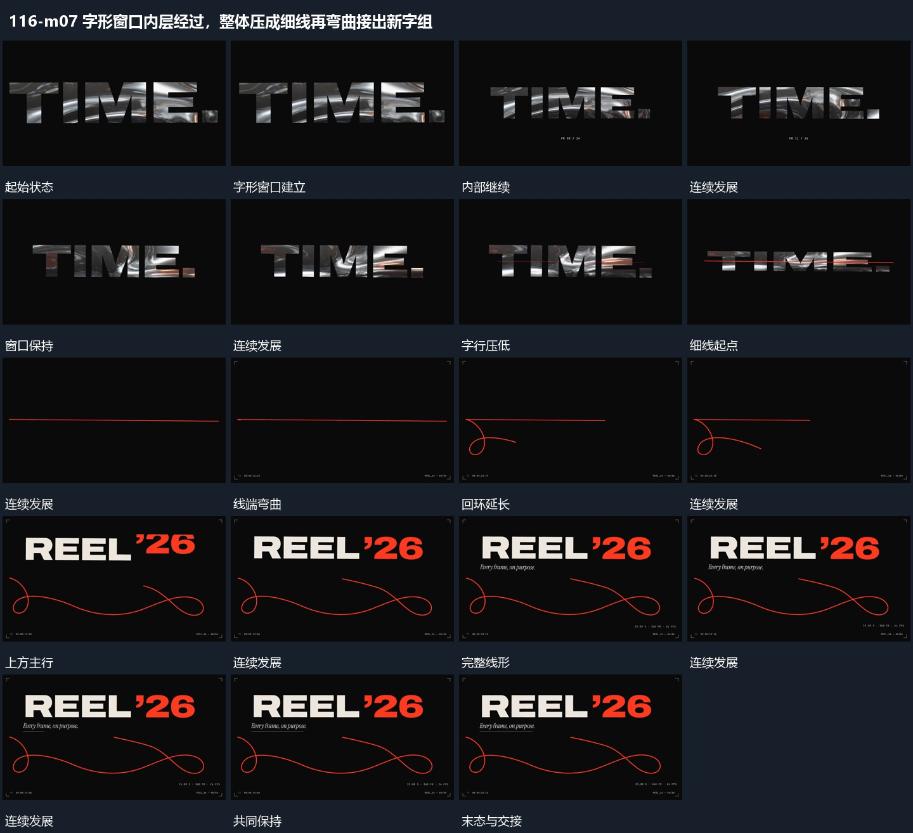

# 字形窗口内层经过，整体压成细线再弯曲接出新字组

## 运动指令

字形窗口保持外轮廓，内部片层持续经过；整行纵向压缩为细线，细线端部沿曲线延伸弯成回环，上方新主行与附属行接力建立。

1. **字形窗口内部图层持续经过外轮廓保持后压成细线**

用完整字形窗口接管原活动图层，字形外轮廓保持，内部图层继续横向或局部转向经过。完成后压低整行高度，上下边缘逐步收近，直到成为一条细线；内部层在收缩中退让。

2. **细线沿路径延长弯成回环主行随后建立**

保留细线的一端，另一端沿弯曲路线前进，身后线逐步延长并形成回环。线形可辨后在上方分段建立主行，下方线仍缓慢改变局部弯曲；附属短行最后接入，共同保持。

整段结束：回环长线与上方主行完整 保留必要落稳与交接，中间已建立的参照沿用到下一步骤。

## 视频切片

[播放本机制的原片切片](m07.mp4)

保留起始准备、连续发展和完成或明确交接；首尾按本段运动范围裁切，不拼接、不变速。相连的小动作合为同一完整段落。

## 分镜过程

## 组合与调整

字形窗口保持外轮廓，内部片层持续经过；整行纵向压缩为细线，细线端部沿曲线延伸弯成回环，上方新主行与附属行接力建立。 复用时可调整元素数量、幅度和相对节奏，保留上述进入、交叠与完成关系；不直接沿用原片题材或时长。

窗口可换其他轮廓；外边界与内部运动分开，不把字形随内部画面一起漂走。

线端方向先明确，不把整条曲线每次换成独立图；可以只保留一个回环。
