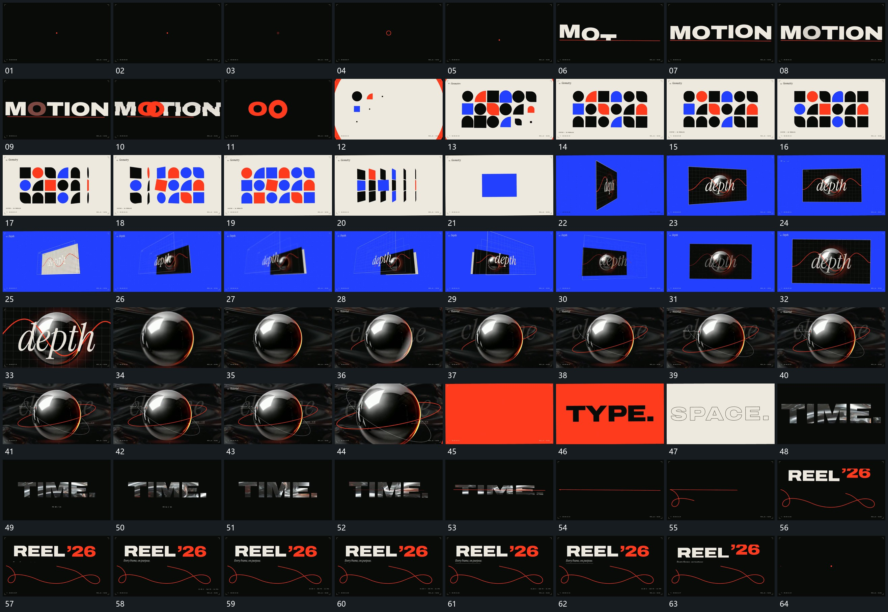

# 116｜原片运动总览

[观看完整原片](video.mp4)

## 运动总览

全片从小点与圈开始，主行逐段建立局部圆形留下作为下一接点逐段建立主行并把其中圆形残留作为转场接点。少量片扩成格阵各片错开转角最后侧立回收从少量片扩成格阵，局部转角与形态接替持续进行。格阵侧立后收为单片，单片转角后多框沿纵深拉开再合回推近让单片沿纵深拉开多个框，再合回并推近。

随后球组保持外围倾角环持续转向与绕行让球组与不同倾角环持续转向，主行改用字形窗口内部图层持续经过外轮廓保持后压成细线的字形窗口承载原内部图层。字行压低成细线后，细线沿路径延长弯成回环主行随后建立继续沿线延长并弯成回环，上方新主行分段接入，最后保持。

## 完整运动段落

以下按原片中的出现顺序引用。建立、内部发展及完成反馈放在同一段中；同时发生的局部动作与运镜写在同一份指令里。不同段之间可以是连续接管，也可以是直接切换，不能仅凭条目相邻认定可直接拼接。重复出现的同类运动采用一次连续代表范围，切片不以逐段无缝覆盖整片为目标。

1. [主行逐段建立局部圆形留下作为下一接点](mechanisms/m01.md)：建立后局部释放

2. [少量片扩成格阵各片错开转角最后侧立回收](mechanisms/m02.md)：累积转角回收

3. [单片转角后多框沿纵深拉开再合回推近](mechanisms/m03.md)：转角分层合回推近

4. [球组保持外围倾角环持续转向与绕行](mechanisms/m04.md)：球局部变化外围转向

5. [字形窗口内层经过，整体压成细线再弯曲接出新字组](mechanisms/m07.md)：字形窗口保持外轮廓，内部片层持续经过；整行纵向压缩为细线，细线端部沿曲线延伸弯成回环，上方新主行与附属行接力建立。

切片保留起始准备、必要内部停顿和完成或明确交接；首尾省略无新发展的等待，持续运动不要求人为停住。以上基于真实源帧序列和重点边界核对，不等同于全片连续声画审片。

## 完整64宫格

