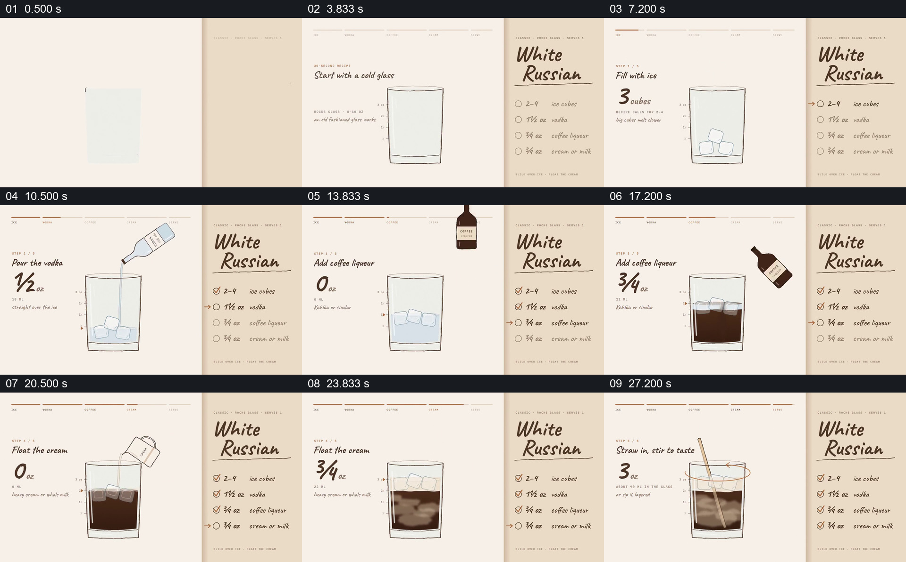

# 让配方清单与同一只杯子的状态同步累积

- 作品：案例 075《配方卡上的一杯调制》（本次概括）。
- 原片范围：00:00.000–00:30.000，含起点、不含终点；[完整原片](../video.mp4)｜[本卡片段](../video.mp4)。
- 观察方式：依据约每秒一次的真实源帧观察，未连续原速观看或听审；声音、语气与完整播放节奏未确认。

## 原画面具体怎样设计

画面像打开的配方册，右侧固定饮品名与配料清单，左侧空杯旁显示当前动作和数量。冰块一块块进入杯中并计数；伏特加、咖啡利口酒和奶油依次倒入，左侧数量递增，杯内颜色与液面随之变化，右侧相应项目依次打勾。最后放入搅拌棒搅拌，成品留在杯中并出现结束文字。

## 为什么这样设计，好在哪里

清单提供全程参照，而同一只杯子保存每一步的结果；动态数量、打勾和材料变化共同交代当前做到哪里，观众不必把多个彼此分离的步骤自行拼起来。具体配方是片中示例，未独立核实。

以上为依据画面的分析，非作者自述；预期观看效果未经观众测试。

## 可直接使用的创意指令

展示需要顺序累积的制作过程时，固定显示经核对的材料清单，并用一个持续可见的容器或作品承接各步；每次加入材料时同时标出当前数量、已完成项目和可见状态变化，最后保留完整成品。材料、比例和实际操作按经过验证的配方确定。
