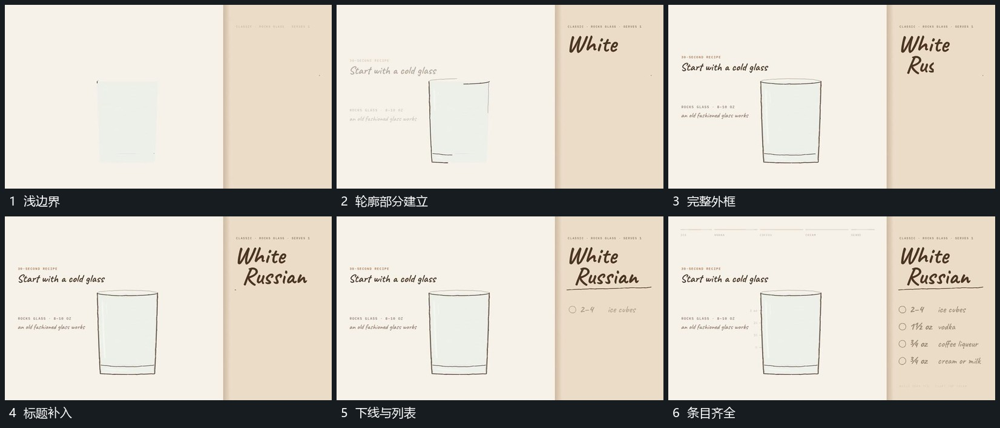

# 轮廓先描出再补标题与列表

## 运动指令

先沿外框边缘逐段描出轮廓，让边线首尾接合后保持。旁侧标题分字补入，下方短线和列表随后逐项增加；每项出现后留在原位，不挤动外框。完成后保留空的内部区域作为下一动作的落点。

## 视频切片

[播放本机制的原片切片](m01.mp4)

覆盖分镜中“浅边界”至“条目齐全”的连续过程，并保留邻近的前后衔接画面；原片中交叠发生的动作一并保留。

## 分镜过程

## 组合与调整

可改变框形与列表数量；外框与落点先稳定，再让内部元素进入。
