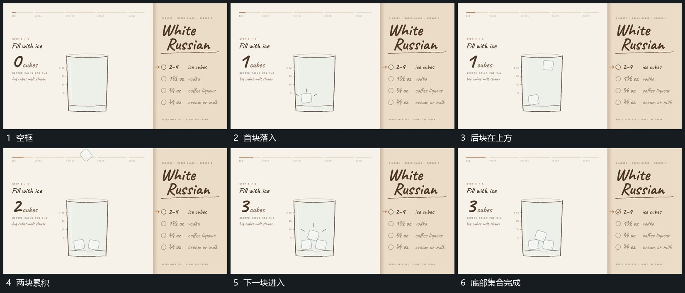

# 小块从上方逐次落入底部并累积

## 运动指令

让首块从上方降入外框，下降中带少量倾角，落到底部后保持。后块沿相近路径错开进入，与已有块相接时改变局部角度和位置，最终形成底部小集合。旁侧数值随每次落入接替，外框始终不动。

## 视频切片

[播放本机制的原片切片](m02.mp4)

覆盖分镜中“空框”至“底部集合完成”的连续过程，并保留邻近的前后衔接画面；原片中交叠发生的动作一并保留。

## 分镜过程

## 组合与调整

可改变数量与落入间隔；后块到达时只调整局部接触关系，不把前块全部清空。
