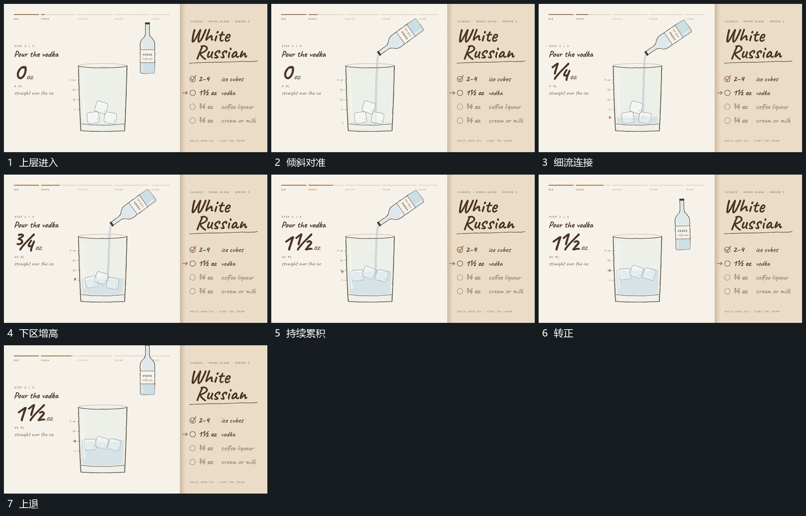

# 上方小容器倾斜接出细流下区逐步增高

## 运动指令

小容器从上方进入并在外框上方停住，绕自身中部倾斜，让开口朝向框内。细流先从开口连接到下区，下区边界随后逐步上升，已有块仍可辨并随内部变化小幅调整。停止流入后容器转正，再沿上方退出。

## 视频切片

[播放本机制的原片切片](m03.mp4)

覆盖分镜中“上层进入”至“上退”的连续过程，并保留邻近的前后衔接画面；原片中交叠发生的动作一并保留。

## 分镜过程

## 组合与调整

重复使用时沿用同一外框和已有层；先断开细流再退出，不让下区随容器一起离开。
