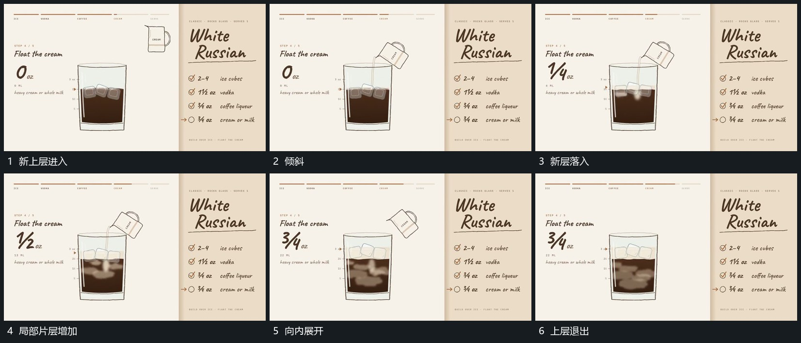

# 流入的新层从落点展开而已有层保持

## 运动指令

新上层对准外框后倾斜，接出向下的短流。新片层先在流入落点附近出现，再向两侧和下方展开成弯曲区域；已有块和底层仍保留，只作局部移动。新增层展开后，上方容器转正退出，内部保持新旧层的连续关系。

## 视频切片

[播放本机制的原片切片](m04.mp4)

覆盖分镜中“新上层进入”至“上层退出”的连续过程，并保留邻近的前后衔接画面；原片中交叠发生的动作一并保留。

## 分镜过程

## 组合与调整

可替换片层形状，重点是从同一落点逐步展开，避免整区瞬间换成另一幅图。
