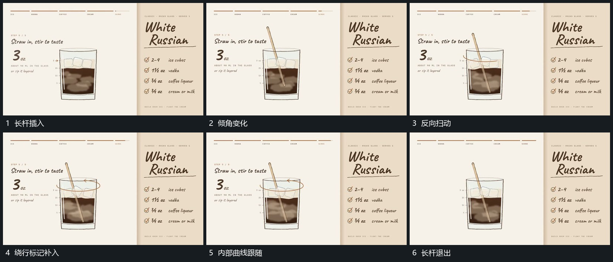

# 长杆插入围中心扫动并带动内部曲线

## 运动指令

长杆从上方插入框内，底端留在内部范围，顶端围中心改变方位与倾角。内部曲线跟随杆的经过位置弯动，外围可补一圈绕行线提示同一方向。动作结束后杆沿上方退出，外框和已累积的区域保持，下方短行最后接入。

## 视频切片

[播放本机制的原片切片](m05.mp4)

覆盖分镜中“长杆插入”至“长杆退出”的连续过程，并保留邻近的前后衔接画面；原片中交叠发生的动作一并保留。

## 分镜过程

## 组合与调整

改变扫动幅度和次数即可；内部响应应跟随杆的位置，不能成为与杆无关的全区闪变。
