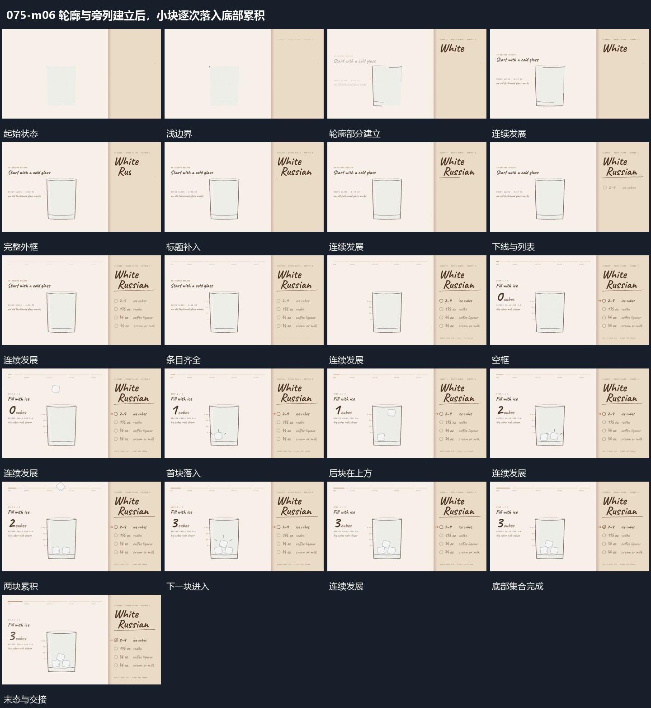

# 轮廓与旁列建立后，小块逐次落入底部累积

## 运动指令

容器轮廓、标题与旁列先建立，内部小块随后依次下落并留在底部，直到累积结果完整。

1. **轮廓先描出再补标题与列表**

先沿外框边缘逐段描出轮廓，让边线首尾接合后保持。旁侧标题分字补入，下方短线和列表随后逐项增加；每项出现后留在原位，不挤动外框。完成后保留空的内部区域作为下一动作的落点。

2. **小块从上方逐次落入底部并累积**

让首块从上方降入外框，下降中带少量倾角，落到底部后保持。后块沿相近路径错开进入，与已有块相接时改变局部角度和位置，最终形成底部小集合。旁侧数值随每次落入接替，外框始终不动。

整段结束：多块堆在框内下方 保留必要落稳与交接，中间已建立的参照沿用到下一步骤。

## 视频切片

[播放本机制的原片切片](m06.mp4)

保留起始准备、连续发展和完成或明确交接；首尾按本段运动范围裁切，不拼接、不变速。相连的小动作合为同一完整段落。

## 分镜过程

## 组合与调整

容器轮廓、标题与旁列先建立，内部小块随后依次下落并留在底部，直到累积结果完整。 复用时可调整元素数量、幅度和相对节奏，保留上述进入、交叠与完成关系；不直接沿用原片题材或时长。

可改变框形与列表数量；外框与落点先稳定，再让内部元素进入。

可改变数量与落入间隔；后块到达时只调整局部接触关系，不把前块全部清空。
