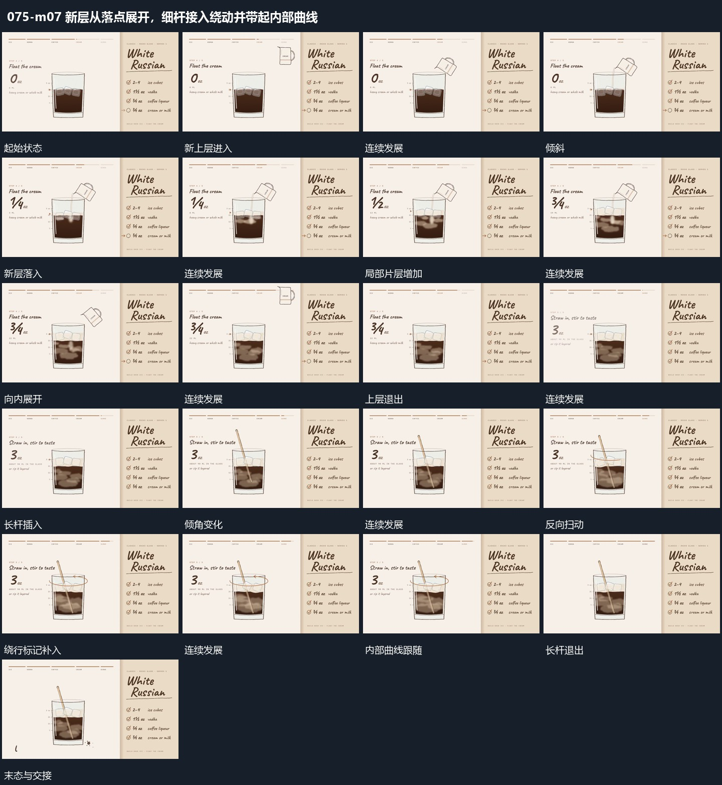

# 新层从落点展开，细杆接入绕动并带起内部曲线

## 运动指令

流入的新层从落点向外扩展，原有层保持；细杆进入围绕中心扫动，带动内部曲线，最后停止完成。

1. **流入的新层从落点展开而已有层保持**

新上层对准外框后倾斜，接出向下的短流。新片层先在流入落点附近出现，再向两侧和下方展开成弯曲区域；已有块和底层仍保留，只作局部移动。新增层展开后，上方容器转正退出，内部保持新旧层的连续关系。

2. **长杆插入围中心扫动并带动内部曲线**

长杆从上方插入框内，底端留在内部范围，顶端围中心改变方位与倾角。内部曲线跟随杆的经过位置弯动，外围可补一圈绕行线提示同一方向。动作结束后杆沿上方退出，外框和已累积的区域保持，下方短行最后接入。

整段结束：长杆上退且内部保持变化后的状态 保留必要落稳与交接，中间已建立的参照沿用到下一步骤。

## 视频切片

[播放本机制的原片切片](m07.mp4)

保留起始准备、连续发展和完成或明确交接；首尾按本段运动范围裁切，不拼接、不变速。相连的小动作合为同一完整段落。

## 分镜过程

## 组合与调整

流入的新层从落点向外扩展，原有层保持；细杆进入围绕中心扫动，带动内部曲线，最后停止完成。 复用时可调整元素数量、幅度和相对节奏，保留上述进入、交叠与完成关系；不直接沿用原片题材或时长。

可替换片层形状，重点是从同一落点逐步展开，避免整区瞬间换成另一幅图。

改变扫动幅度和次数即可；内部响应应跟随杆的位置，不能成为与杆无关的全区闪变。
