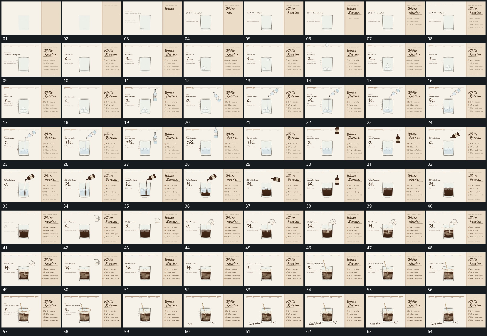

# 075｜原片运动总览

[观看完整原片](video.mp4)

## 运动总览

全片固定同一外框，用轮廓先描出再补标题与列表先描出边界，再补标题与多行条目；小块从上方逐次落入底部并累积让小块从上方逐次落入并累积。之后两次复用上方小容器倾斜接出细流下区逐步增高，上方小容器进入、倾斜，细流连接到下区，下区增长后容器转正退出。

第三次加入改用流入的新层从落点展开而已有层保持，新片层从流入位置展开，已有块和区域保持可辨。最后长杆插入围中心扫动并带动内部曲线让长杆插入、围中心扫动并带动内部曲线，旁侧完成标记接入，下方短字在同一框架下收尾。

## 完整运动段落

以下按原片中的出现顺序引用。建立、内部发展及完成反馈放在同一段中；同时发生的局部动作与运镜写在同一份指令里。不同段之间可以是连续接管，也可以是直接切换，不能仅凭条目相邻认定可直接拼接。重复出现的同类运动采用一次连续代表范围，切片不以逐段无缝覆盖整片为目标。

1. [轮廓与旁列建立后，小块逐次落入底部累积](mechanisms/m06.md)：容器轮廓、标题与旁列先建立，内部小块随后依次下落并留在底部，直到累积结果完整。

2. [上方小容器倾斜接出细流下区逐步增高](mechanisms/m03.md)：倾斜流入后转正上退

3. [新层从落点展开，细杆接入绕动并带起内部曲线](mechanisms/m07.md)：流入的新层从落点向外扩展，原有层保持；细杆进入围绕中心扫动，带动内部曲线，最后停止完成。

切片保留起始准备、必要内部停顿和完成或明确交接；首尾省略无新发展的等待，持续运动不要求人为停住。以上基于真实源帧序列和重点边界核对，不等同于全片连续声画审片。

## 完整64宫格

