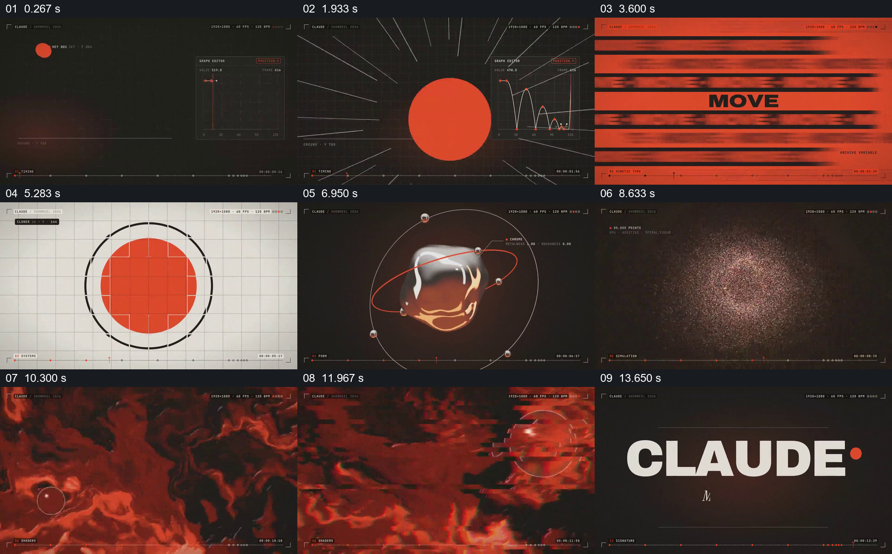

# 用圆形和红色线索串联多种运动图像

- 作品：案例 114《红色圆形到多种运动图像》（本次概括）。
- 原片范围：00:00.000–00:15.061，含起点、不含终点；[完整原片](../video.mp4)｜[本卡片段](../video.mp4)。
- 观察方式：依据约每秒一次的真实源帧观察，未连续原速观看或听审；声音、语气与完整播放节奏未确认。

## 原画面具体怎样设计

黑底小球旁出现运动曲线，随后浅色网格和红底 MOVE 文字交替；圆形由线框和红色填充组成，接到金属物体与绕行线条，再变成亮光、旋涡粒子和红色纹理，立方网格出现后落到品牌名称。

## 为什么这样设计，好在哪里

红色与圆形在不同材料中反复出现，给多段抽象图像共同的识别线索；形态从简单图形扩大到材质和粒子空间，形成视觉范围的变化。快切动作与声音未确认。

以上为依据画面的分析，非作者自述；预期观看效果未经观众测试。

## 可直接使用的创意指令

展示多种抽象运动时，选一个可辨的基础形状或颜色贯穿平面、材质与空间形式，安排各段清晰建立与接续，最后收束到统一身份。每段内容应源于实际实验，而非只替换标签。
