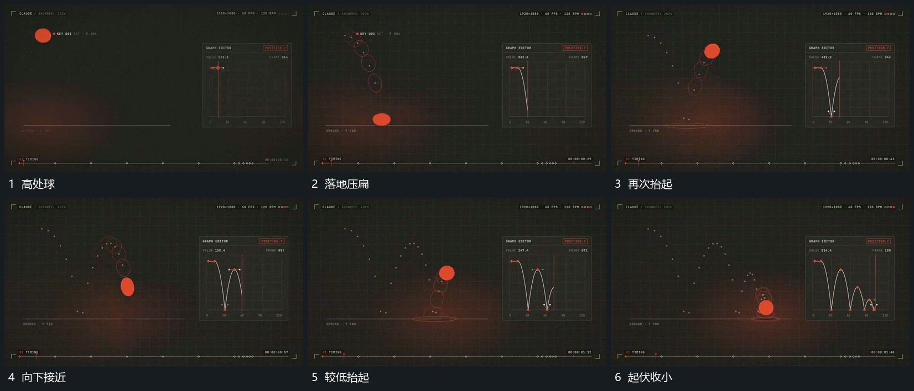

# 球沿前方连续起落每次落地压扁再恢复

## 运动指令

球沿前方下降，接近底线时压扁并向两侧稍展，随后抬起、收窄并恢复。下一次落地继续同类变化，但起伏高度逐步收小，浅点迹保留已走路径，底线位置不动。

## 视频切片

[播放本机制的原片切片](m01.mp4)

覆盖分镜中“高处球”至“起伏收小”的连续过程，并保留邻近的前后衔接画面；原片中交叠发生的动作一并保留。

## 分镜过程

## 组合与调整

不要求真实物理模拟；每次恢复在离地过程中完成，不突然跳回圆形。
