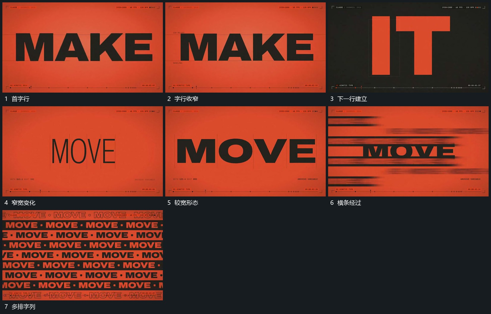

# 字行宽厚连续变化后多排字列错开经过

## 运动指令

保留中央字行的基线，连续改变字形宽度与笔画厚度，字距同步调整。字行完成变化后引入多排重复字列，各排错开横向经过，中央原行退让，形成满幅连续行列。

## 视频切片

[播放本机制的原片切片](m02.mp4)

覆盖分镜中“首字行”至“多排字列”的连续过程，并保留邻近的前后衔接画面；原片中交叠发生的动作一并保留。

## 分镜过程

## 组合与调整

可以只用其中一段；不推定原字体轴，换成几何线组也可实现宽厚变化。
