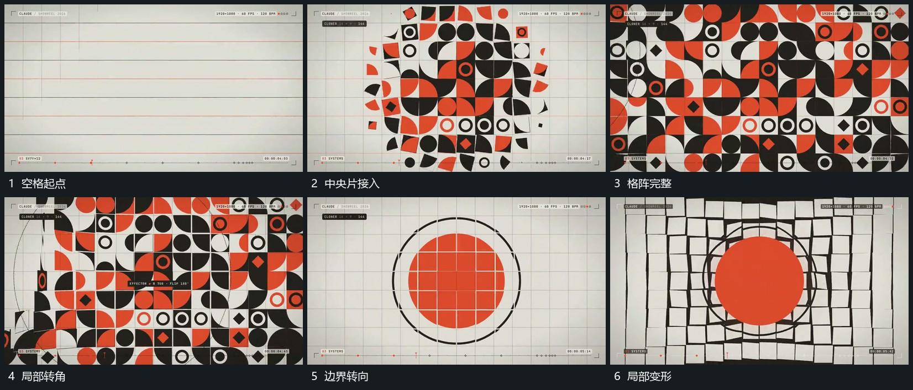

# 中央片组向外补成格阵局部形态逐项转向

## 运动指令

从中央少量片面开始向周边补齐格位，每片入场后保持所在范围。完整格阵建立后，局部片围自身中心转向或改变轮廓，相邻片错开接上；总体外边界可少量弯动，但格位仍可辨。

## 视频切片

[播放本机制的原片切片](m03.mp4)

覆盖分镜中“空格起点”至“局部变形”的连续过程，并保留邻近的前后衔接画面；原片中交叠发生的动作一并保留。

## 分镜过程

## 组合与调整

新片选择有限形态即可；不要把格阵全部随机换成另一套排列。
