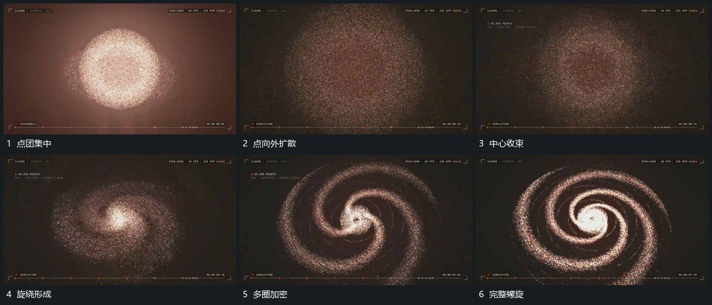

# 点团先扩散再收成平面螺旋并加密圈层

## 运动指令

中央点团先向外散开，中心附近点随后转向，沿旋绕方向重新汇成几条弧形带。弧带继续延长并逐步加密为多圈螺旋，外围点接入后保持相同绕行方向，中心仍保留。

## 视频切片

[播放本机制的原片切片](m05.mp4)

覆盖分镜中“点团集中”至“完整螺旋”的连续过程，并保留邻近的前后衔接画面；原片中交叠发生的动作一并保留。

## 分镜过程

## 组合与调整

只描述重排与旋绕，不声称真实粒子模型；中间扩散不要直接跳为完整螺旋图。
