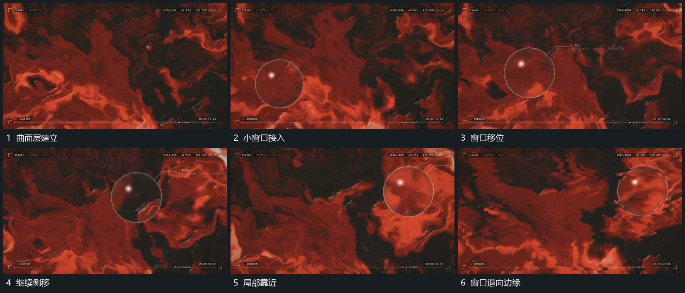

# 满幅曲面局部卷动小圆窗口侧向经过

## 运动指令

满幅曲面层的局部持续卷动与拉伸，边界之间有连续转向。小圆窗口在前层从一侧向另一侧经过，窗口内保持同一区域参照，外边界清楚；经过中可略放大，最后退向边缘。

## 视频切片

[播放本机制的原片切片](m06.mp4)

覆盖分镜中“曲面层建立”至“窗口退向边缘”的连续过程，并保留邻近的前后衔接画面；原片中交叠发生的动作一并保留。

## 分镜过程

## 组合与调整

可用抽象弯曲片层，窗口运动不要与满幅卷动同幅漂移。
