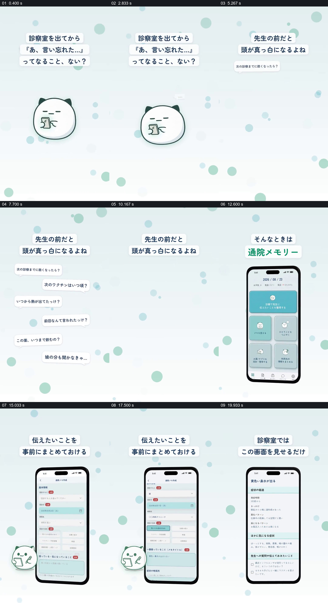

# 让就诊时想不起的问题，变成事先整理并可查看的清单

- 作品：案例 050《就诊管理、成员选择与药品照片展示》（库内索引名）。
- 原片范围：00:00.000–00:22.000，含起点、不含终点；[完整原片](../video.mp4)｜[本卡片段](c01.mp4)，片段起点对应原片 0.000 秒。
- 范围依据：0–22 秒从就诊后的遗忘问题到提前填写和现场查看，形成完整的问题与使用结果；后续改为介绍家庭成员及其他资料类型。
- 观察方式：核看全片 64 帧总览及本卡九宫格；未独立连续原速观看，快速变化和运动节奏待核。未独立听审，声音内容未知。片中事实和演示未独立查证，新题材迁移尚未实测。

## 原画面具体怎样设计

浅青色竖画幅上有大小不同的圆点，中央是一只拿着手机的圆形猫角色；上方日文大意是离开诊室后才想起忘了说的事。随后角色退去，画面中分散出现多条白色小气泡，分别涉及下次就诊前变化、疫苗、发热何时开始、上次医嘱及家人的问题。

疑问气泡退场后，产品标志及手机主页进入。手机上方文字说明可以提前整理想告诉医生的内容，屏内由主页切到表单，逐步显示就诊人、日期、机构、目的及需要说明的症状等字段，旁边的小猫拿着纸笔。后面手机页面变为分段清单，上方文字说明在诊室展示这个页面；清单中可见症状经过、其他关注症状和要询问医生的内容。画面展示的是产品示意，不能证明这些内容属于真实就诊或已经得到医疗判断。

## 为什么这样设计，好在哪里

片子先把“想不起来”拆成不同具体问题，让观众看到为什么需要准备；之后这些零散问题不必再以气泡占满画面，而是进入一个可填写、可分段阅读的手机页面。猫角色从拿手机变成拿纸笔，为情境和记录操作提供共同的视觉伙伴；浅色背景与上方短句持续存在，帮助观众跟随不同界面。最终展示的是现场能使用的整理结果，解决的不只是“有个记录功能”。

若没有开始的具体疑问，表单只是一个功能截图；若没有最后的可查看清单，就少了说明“记录之后怎样用于沟通”的结果。以上基于画面分析，不是对实际就诊效果的验证。

## 可直接使用的创意指令

需要解释事前整理信息的工具时，先列出几项真实会遗忘或容易混淆的问题，让每项以可读的独立元素出现；随后展示如何将它们归入一份有明确对象和时间的记录，保留填写前后关系。完成后给出可在实际会面中查看的清单，让问题、分类和最终用途保持对应。角色、背景、设备样式与文字位置可自由替换；示例健康信息要经授权或清楚标为模拟，清单用于沟通和核对，不能代替专业诊断。
