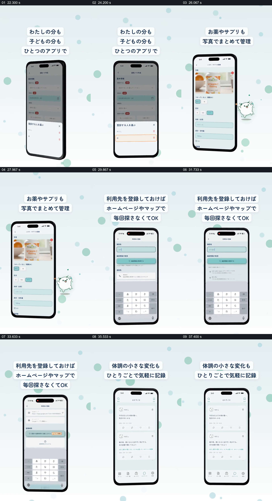

# 用同一手机和短标题依次展示家庭资料的几种记录

- 作品：案例 050《就诊管理、成员选择与药品照片展示》（库内索引名）。
- 原片范围：00:22.000–00:39.000，含起点、不含终点；[完整原片](../video.mp4)｜[本卡片段](c02.mp4)，片段起点对应原片 22.000 秒。
- 范围依据：22–39 秒在同一设备展示位轮流介绍成员选择、药品照片、机构和日常记录；它们是并列例子，39 秒后为品牌下载尾卡。
- 观察方式：核看全片 64 帧总览及本卡九宫格；未独立连续原速观看，快速变化和运动节奏待核。未独立听审，声音内容未知。片中事实和演示未独立查证，新题材迁移尚未实测。

## 原画面具体怎样设计

浅青圆点背景继续保留，顶部三行日文说明自己和孩子的信息可以放在一个应用中。手机里的就诊表单变暗，底部弹出成员选择层，能看到本人和孩子两行，选中行被框出。

手机保持画面中的主要位置，上方文字随后改成药物和补充剂可通过照片管理；手机里出现维生素瓶图片、使用人选项、类别、名称与含量输入框，小猫出现在旁边。再换到机构资料页面，屏内输入机构名并出现候选和网址等字段；上方说明登记后不用每次重新寻找网页或地图。最后手机显示按时间排列的简短身体状态记录，上方说明可以随手记下小变化，随后手机退出并转入品牌结束页。各页面是不同功能示例，不表示这些操作已经实际发生，也没有独立核实隐私处理。

## 为什么这样设计，好在哪里

不同资料并不强行堆成一张复杂总表，而是让同一手机外壳逐次承载成员选择、药物图片、机构字段和日常记录，上方短句同步说明正在看哪一类。每次都用实际界面位置和一个具体例子落地，观众可以把抽象的“家庭资料管理”拆成几件可想象的事。统一的浅色背景和小猫使多个功能仍属于同一个产品系列，但这些例子之间没有证据证明存在自动同步或因果关系。若只保留重复手机而没有相应标题与可辨字段，功能区别会变得模糊；以上是画面组织分析，未做功能或受众验证。

## 可直接使用的创意指令

需要介绍一个工具中的多类资料时，先选与同一使用情境有关、但用途不同的几个真实或模拟例子。保持设备或展示容器的位置作为参照，每次只突出一种资料：显示它属于谁、需要填写或查看什么，以及能得到什么可见状态；用简短标题同步点明当前例子的作用。例子之间应如实说明是并列功能还是实际关联，不用转场暗示自动同步。健康、药物与家庭成员资料应明确授权、归属和真实存储分享方式，敏感字段和含量按实际用途核对。
