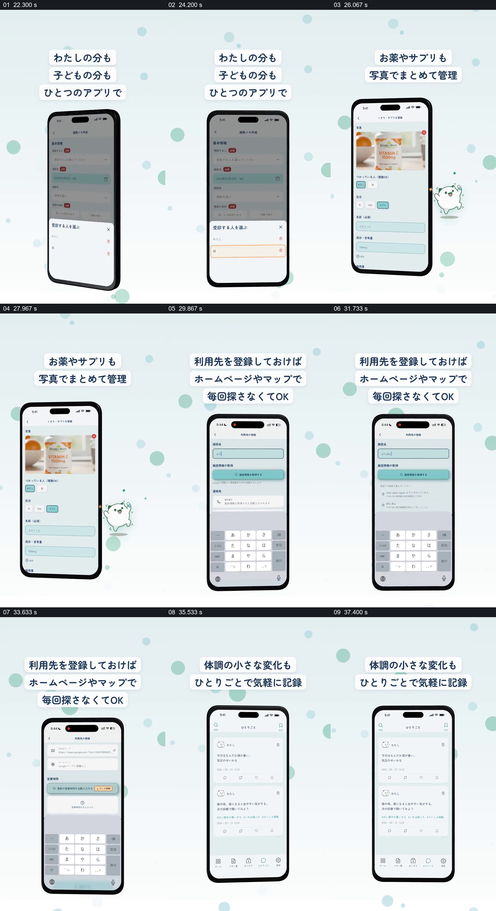

# 用同一手机和短标题依次展示家庭资料的几种记录

- 作品：案例 050《就诊管理、成员选择与药品照片展示》（库内索引名）。
- 原片范围：00:22.000–00:39.000，含起点、不含终点；[完整原片](../video.mp4)｜[本卡片段](c02.mp4)，片段起点对应原片 22.000 秒。
- 范围依据：22–39 秒在同一设备展示位轮流介绍成员选择、药品照片、机构和日常记录；它们是并列例子，39 秒后为品牌下载尾卡。
- 观察方式：核看全片 64 帧总览及本卡九宫格；未独立连续原速观看，快速变化和运动节奏待核。未独立听审，声音内容未知。片中事实和演示未独立查证，新题材迁移尚未实测。

## 原画面具体怎样设计

浅青圆点背景继续保留，顶部三行日文说明自己和孩子的信息可以放在一个应用中。手机里的就诊表单变暗，底部弹出成员选择层，能看到本人和孩子两行，选中行被框出。

手机保持画面中的主要位置，上方文字随后改成药物和补充剂可通过照片管理；手机里出现维生素瓶图片、使用人选项、类别、名称与含量输入框，小猫出现在旁边。再换到机构资料页面，屏内输入机构名并出现候选和网址等字段；上方说明登记后不用每次重新寻找网页或地图。最后手机显示按时间排列的简短身体状态记录，上方说明可以随手记下小变化，随后手机退出并转入品牌结束页。各页面是不同功能示例，不表示这些操作已经实际发生，也没有独立核实隐私处理。

## 为什么这样设计，好在哪里

不同资料并不强行堆成一张复杂总表，而是让同一手机外壳逐次承载成员选择、药物图片、机构字段和日常记录，上方短句同步说明正在看哪一类。每次都用实际界面位置和一个具体例子落地，观众可以把抽象的“家庭资料管理”拆成几件可想象的事。统一的浅色背景和小猫使多个功能仍属于同一个产品系列，但这些例子之间没有证据证明存在自动同步或因果关系。若只保留重复手机而没有相应标题与可辨字段，功能区别会变得模糊；以上是画面组织分析，未做功能或受众验证。

## 完整照排指令

以[完整原片](../video.mp4)的 22–39 秒为准。画幅 720×1280，源帧率 30/1。以下拍点为抽帧定位，位置按画幅百分比取近似值。

### 用料

【家庭切换页】【药品照片页】【机构输入页】【身体记录页】使用同一授权演示账号或可辨的资料档案，避免暴露个人病情和联络字段。备【家庭标题】【药品标题】【机构标题】【记录标题】【品牌图标】【品牌字】【下载短句】【商店入口】【吉祥物】。功能与下载入口须可核对。

### 按源时刻摆放

1. **22–约 25 秒。** 竖幅浅青白及薄荷散点。顶部三条浅白贴纸排深字【家庭标题】，中下黑细手机仍暗屏，底部亮白【家庭切换页】从下抬起，选中行用浅橙框或底色。保持同一外框，切换后恢复亮屏。
2. **约 25–29 秒。** 顶部换同字级【药品标题】，内屏【药品照片页】上方给暖色小照、下方青绿信息块。画外小【吉祥物】短出右侧。手机保持中轴，允许轻微倾斜，页面内容在机内不漂。
3. **约 29–34 秒。** 顶部改【机构标题】，原手机换【机构输入页】，中段浅青输入和提示，下部灰白键盘保持，分次录入。再在原位换【身体记录页】，顶部以两行黑粗【记录标题】说明，屏内浅青分区并滚动。每个动态窗从入场到下一功能切出使用对应连续录屏，或静图逐态替换，勿反复重置编辑操作。
4. **约 34–39 秒。** 手机退场，背景与小青点留。中轴先显浅绿方【品牌图标】，下接青粗【品牌字】、亮青短【下载短句】及黑色【商店入口】，【吉祥物】最后放其下。按39秒切出。

### 局部采用

单一记录类型可截其标题与手机同屏的完整一拍。只有可达下载入口可取约 36–39 秒。

### 验证状态

已对照逐秒原片画序并读回，核对底部家庭选择、药品照片、键盘、记录页及品牌层级。精确帧、界面原字和换料待核。
