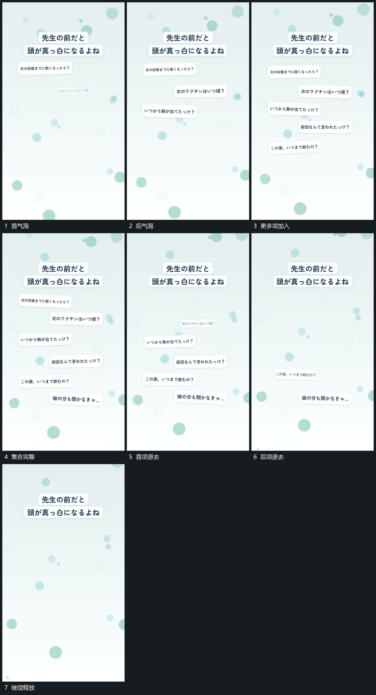

# 分散气泡逐项增加，再按位置逐步退去

## 运动指令

把气泡错开接入分散空位，前项留住，后项依次增加。集合完整后逐项退去，保留原位置的来源感，不让退出阶段重新排列成另一集合。

## 视频切片

[播放本机制的原片切片](m01.mp4)

覆盖分镜中“首气泡”至“继续释放”的连续过程，并保留邻近的前后衔接画面；原片中交叠发生的动作一并保留。

## 分镜过程

## 组合与调整

气泡数可减，入场与退出应各有明确先后。
