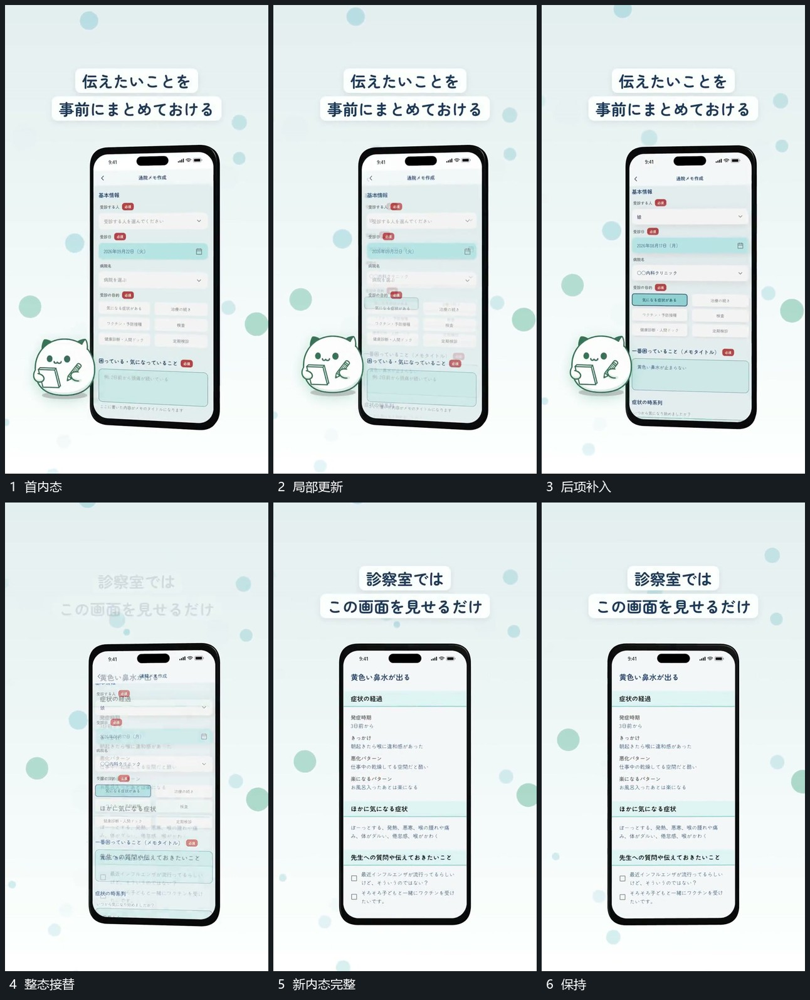

# 固定竖框内态接替，局部短行依次更新

## 运动指令

保留竖框边界与上方字条，内部材料逐段接替。每个状态中局部短行先后更新，已有区域保持；下一整态建立后再继续局部动作。

## 视频切片

[播放本机制的原片切片](m03.mp4)

覆盖分镜中“首内态”至“保持”的连续过程，并保留邻近的前后衔接画面；原片中交叠发生的动作一并保留。

## 分镜过程

## 组合与调整

可以替换任何材料，不把原片表单功能当作运动指令。
