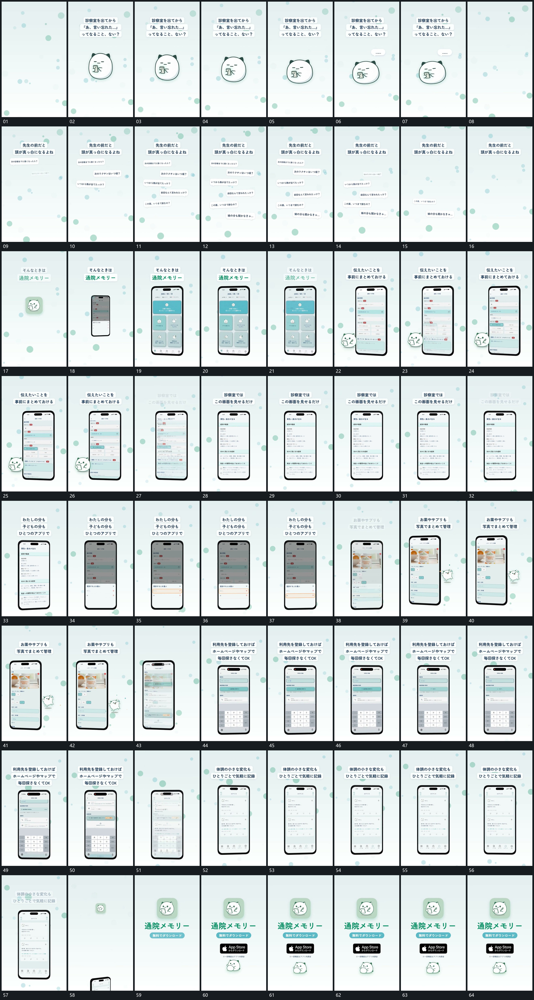

# 050｜原片运动总览

[观看完整原片](video.mp4)

## 运动总览

开头主形轻微起伏，短气泡接入；分散气泡逐项增加，再按位置逐步退去 让分散气泡逐项增加，再按原位置逐步退去。小形退出，竖框由小放大，上方字条分行建立 将中央小形交给由小放大的竖框，上方字条分行建立。

中段 固定竖框内态接替，局部短行依次更新 保留框边界，内态接替，局部短行和字段逐项更新；底部片向上展开，底层变暗后局部边界顺序转移 底部片向上展开，底层变暗，局部边界依次转向不同短行。后段继续用 固定竖框内态接替，局部短行依次更新 更新材料，下部格组先建立，长条逐字输入后补入局部短片 下部格组先建立，长条逐字输入后局部短片补入。末段框退向下边缘，中央小形放大，主字、短条与附属项依次补齐并保持。

## 完整运动段落

以下按原片中的出现顺序引用。建立、内部发展及完成反馈放在同一段中；同时发生的局部动作与运镜写在同一份指令里。不同段之间可以是连续接管，也可以是直接切换，不能仅凭条目相邻认定可直接拼接。重复出现的同类运动采用一次连续代表范围，切片不以逐段无缝覆盖整片为目标。

1. [分散气泡逐项增加，再按位置逐步退去](mechanisms/m01.md)：先累积，后逐项释放

2. [竖框放大建立，字组接入后框内换态并逐行更新](mechanisms/m06.md)：小形退去让竖框从小放大，上方文字建立；外框保持，内部状态接替并更新局部短行，直到本轮结果完整。

3. [底部片向上展开，底层变暗后局部边界顺序转移](mechanisms/m04.md)：展开先发生，边界再移动

4. [下部格组先建立，长条逐字输入后补入局部短片](mechanisms/m05.md)：格组在下，输入在上，反馈后到

切片保留起始准备、必要内部停顿和完成或明确交接；首尾省略无新发展的等待，持续运动不要求人为停住。以上基于真实源帧序列和重点边界核对，不等同于全片连续声画审片。

## 完整64宫格

