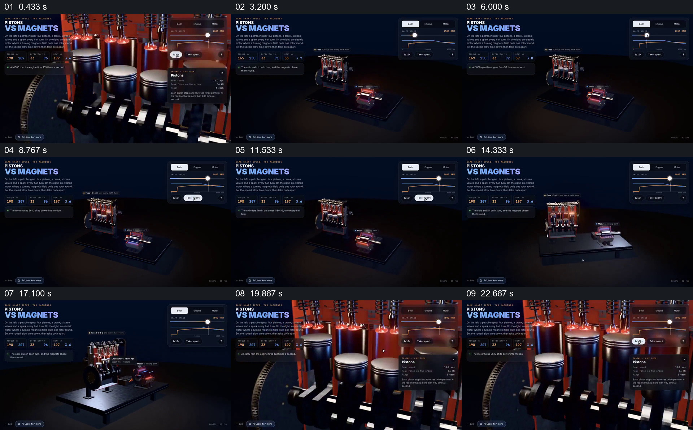

# 在对照界面里保留两个模型，再靠近其中一个结构

- 作品：案例 102《机械对照界面的整体与局部》（本次概括）。
- 原片范围：00:00.000–00:25.000，含起点、不含终点；[完整原片](../video.mp4)｜[本卡片段](c01.mp4)。
- 观察方式：依据约每秒一次的真实源帧观察，未连续原速观看或听审；声音、语气与完整播放节奏未确认。

## 原画面具体怎样设计

画面先近看多缸活塞及标题 PISTONS VS MAGNETS；视点拉远，两个不同模型位于同一底座，左侧说明、数值与右上图表保持。控制位置和数字变化时，两组模型仍同时出现；随后视点靠近活塞模型，展示多个活塞和曲轴附近。

## 为什么这样设计，好在哪里

共享底座与相同界面为两种结构提供比较位置，先看整体再放大局部帮助定位活塞。画面与数字属于演示界面，不足以证明实测性能。

以上为依据画面的分析，非作者自述；预期观看效果未经观众测试。

## 可直接使用的创意指令

解释两种结构差异时，保持同一尺度或明确比例，把实际比较指标和两者并置；在整体关系建立后进入关键部件，并让指标与对应模型可追踪。物理数据和比较条件须有可靠依据。
