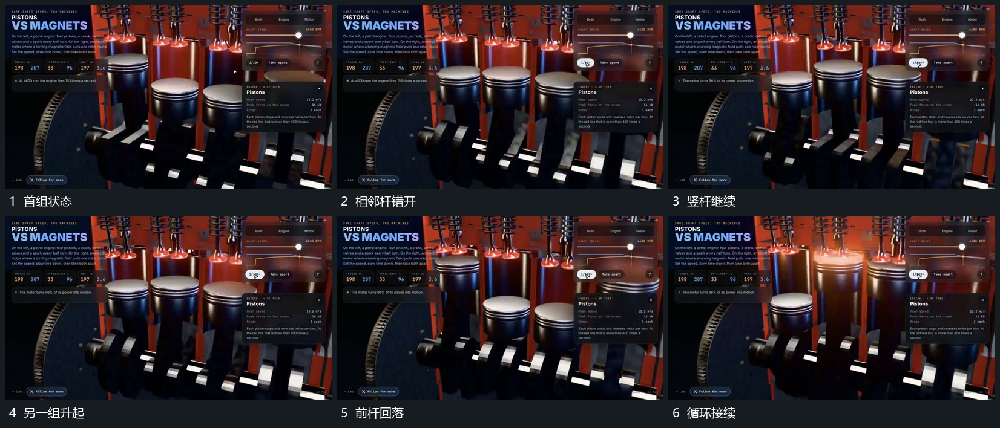

# 多个竖杆错峰往复下方连接连续转向

## 运动指令

让多个竖杆沿各自轴线往复升降，相邻杆错开高低状态。下方连接持续转向，与每根杆的接点保持相连；一根升起时其他杆可以回落，整组支架不动，形成连续循环。

## 视频切片

[播放本机制的原片切片](m01.mp4)

覆盖分镜中“首组状态”至“循环接续”的连续过程，并保留邻近的前后衔接画面；原片中交叠发生的动作一并保留。

## 分镜过程

## 组合与调整

先安排各杆相位再实现接点；不反推原装置的转速、传动比或真实性能。
