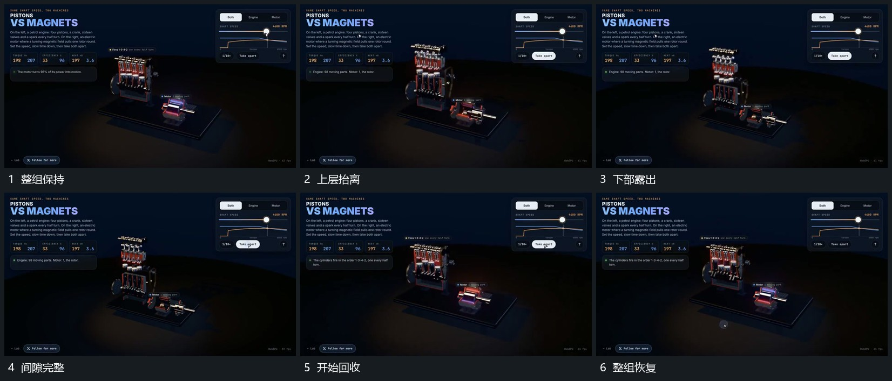

# 上层纵向抬离露出下部再原位合回

## 运动指令

保持下部支架，上层沿纵向抬离，连接处的间隙逐步增加，下方部件从原位置露出。分离后短暂保持，上层再沿相同方向降回，直到恢复原叠合状态；下方局部往复可以继续。

## 视频切片

[播放本机制的原片切片](m03.mp4)

覆盖分镜中“整组保持”至“整组恢复”的连续过程，并保留邻近的前后衔接画面；原片中交叠发生的动作一并保留。

## 分镜过程

## 组合与调整

分离和运动同时存在时保护接点可辨；不把上层拆成无来源的新组。
