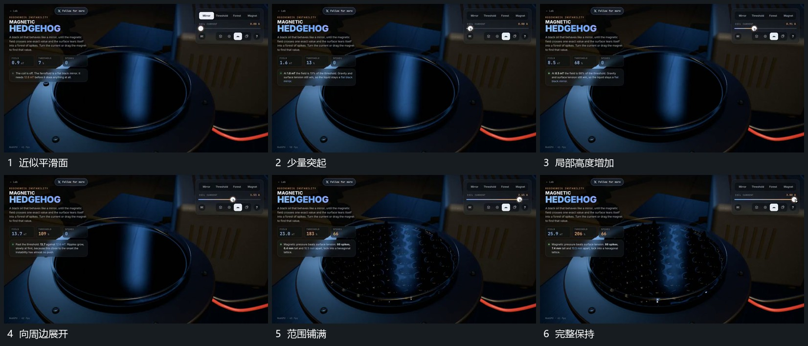

# 圆形面细突起从局部到周边逐步增加

## 运动指令

在圆形面的局部先增加少量细突起，已有突起逐步增高，邻近区域随后接上。变化范围从中部向周边扩展，圆形外边界保持，整体形成密集但高度不同的表面；完成后只保留局部细微变化。

## 视频切片

[播放本机制的原片切片](m04.mp4)

覆盖分镜中“近似平滑面”至“完整保持”的连续过程，并保留邻近的前后衔接画面；原片中交叠发生的动作一并保留。

## 分镜过程

## 组合与调整

可以采用抽象柱阵，避免声称真实材料行为；展开有方向和先后，不全区同刻长满。
