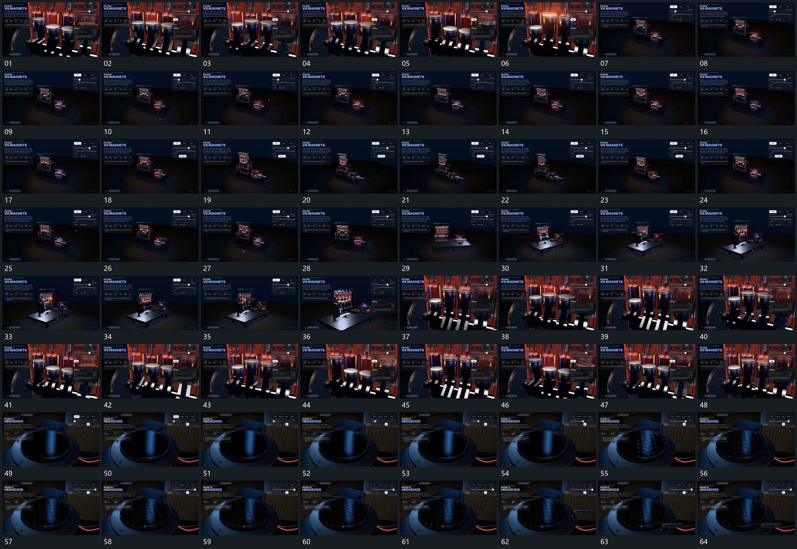

# 102｜原片运动总览

[观看完整原片](video.mp4)

## 运动总览

全片先以多个竖杆错峰往复下方连接连续转向让多个竖杆错峰往复，并保持下方连接连续。退到全貌转角后推入局部持续运动退到全貌、转角再推向局部，竖杆往复始终持续。中间上层纵向抬离露出下部再原位合回把上层沿纵向抬离，露出下层后再合回。

后段换到一个圆形面，圆形面细突起从局部到周边逐步增加从局部开始增加细突起，逐渐向周边扩展并保持；其后只作少量观察转角。旁侧短项接替是附属变化，不把原数字与解释写进运动指令。

## 完整运动段落

以下按原片中的出现顺序引用。建立、内部发展及完成反馈放在同一段中；同时发生的局部动作与运镜写在同一份指令里。不同段之间可以是连续接管，也可以是直接切换，不能仅凭条目相邻认定可直接拼接。重复出现的同类运动采用一次连续代表范围，切片不以逐段无缝覆盖整片为目标。

1. [往复结构退镜转角，顶层抬离再合回后推近局部](mechanisms/m05.md)：竖向部件持续错峰往复，下方连接随动；取景从局部退至整体并转角，顶层抬开露出下层，再原位合回，最后推近局部。

2. [圆形面细突起从局部到周边逐步增加](mechanisms/m04.md)：局部增高向周边扩展

切片保留起始准备、必要内部停顿和完成或明确交接；首尾省略无新发展的等待，持续运动不要求人为停住。以上基于真实源帧序列和重点边界核对，不等同于全片连续声画审片。

## 完整64宫格

