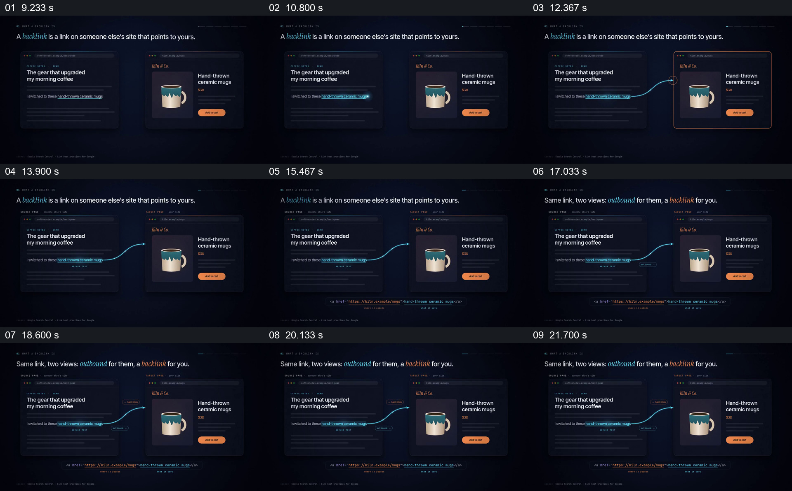

# 用两张网页和同一条箭头解释链接的两种视角

- 作品：案例 053，反向链接可视化解释（库内案例）。
- 原片范围：9.000–23.000 秒；[完整原片](../video.mp4)｜[本卡片段](c01.mp4)。范围含起点、不含终点。
- 观察方式：查看整片 64 帧和本卡九宫格；未独立连续原速观看或听审，动态、停顿、声音与同步仍未知。案例和政策作为片中内容记录，迁移未经实测。

## 原画面具体怎样设计

深蓝背景上方写出反向链接定义；左边浏览器窗口是介绍晨间咖啡器具的文章，右边是陶瓷杯商品页。左文中“hand-thrown ceramic mugs”被蓝色下划线强调，右边对应同一只杯子；随后一条蓝色曲线从这段文字连至商品页，目标页边缘出现强调色。

两窗口保持原位，下方出现一行链接代码，分别以颜色标注地址与可见锚文本。上方标题换为“同一链接，两种视角”，箭头起点旁出现 outbound，目标页旁出现 backlink；网页、商品图、文字与箭头仍同屏保留。

## 为什么这样设计，好在哪里

先建立两个具体页面和共同的杯子，再将链接从文章中实际文字连到目标，抽象关系有明确起点与终点。相同箭头两端放不同名称，使观众能理解名称取决于观察位置，而不是误以为存在两条关系。底部代码对应画面文字与目标地址，补足页面表现与结构之间的关系。

页面和地址是片中示例；此分析不证明实际网站之间存在链接，也不靠静帧推断箭头的运动曲线。

## 可直接使用的创意指令

当一个有向关系在两端名称或角色不同时，选择能认出起点和终点的真实示例，同屏建立两者，再从明确的出发对象连向明确目标。保持同一条连接，分别在两端标注各自视角；若还需要解释底层结构，将可见名称与目标字段对应出来。

网页、商品、箭头形状和颜色都可改变；关键是起点、方向、目标与两个视角的关系。实际链接与名称应可核对，避免把示意图当作真实引用。
