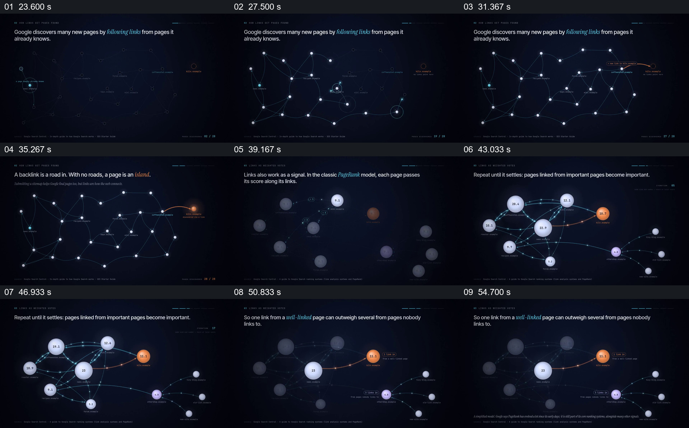

# 从链接网络扩展到页面权重的比较

- 作品：案例 053《网页反向链接的图解》（索引名称）。
- 原片范围：00:23.000–00:58.000，含起点、不含终点；[完整原片](../video.mp4)｜[本卡片段](c02.mp4)。
- 观察方式：依据整片 64 宫格和约每秒一次的真实源帧观察，未连续原速观看或听审；声音、语气与完整播放节奏未确认。

## 原画面具体怎样设计

深色画面中页面节点与连线逐步出现，橙色节点位于右侧；随后节点变为带数值的圆，连线变密，部分节点扩大。画面最终突出一个较大节点到目标的连接，同时保留较小节点的多条连接。

## 为什么这样设计，好在哪里

先建立网络，再改变节点与连接，可将抽象的发现和权重放在同一关系图中。数值和经典模型是示意，不能代表当前搜索排名算法。

以上为依据画面的分析，非作者自述；预期观看效果未经观众测试。

## 可直接使用的创意指令

解释网络中的发现或权重时，先用少量有明确身份的节点建立连接方向，再按经过核实的模型展示权重传递与对照；标明这是简化模型，不把图中分数冒充真实排名。
