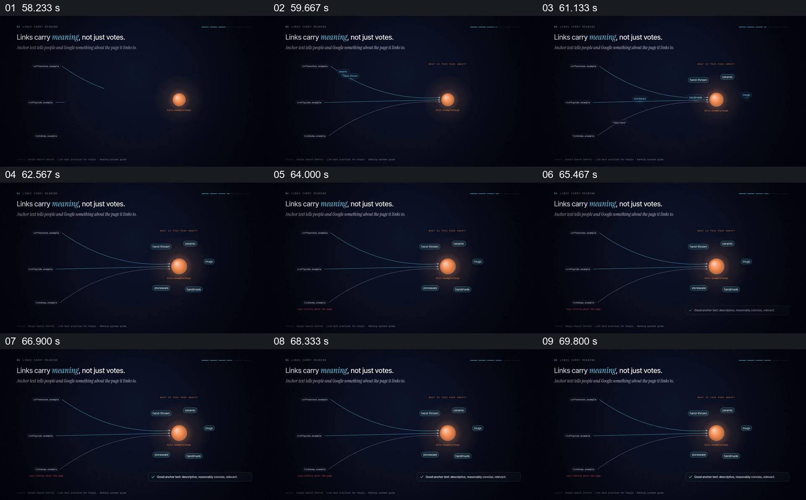

# 用多条带文字的链接汇向同一个页面

- 作品：案例 053《网页反向链接的图解》（索引名称）。
- 原片范围：00:58.000–01:11.000，含起点、不含终点；[完整原片](../video.mp4)｜[本卡片段](c03.mp4)。
- 观察方式：依据整片 64 宫格和约每秒一次的真实源帧观察，未连续原速观看或听审；声音、语气与完整播放节奏未确认。

## 原画面具体怎样设计

橙色目标节点在右侧，左侧多条线汇向它，每条线旁出现不同文字；目标周围逐步显示相关词语，底部出现关于描述性锚文本的提示。

## 为什么这样设计，好在哪里

相同目的地保持稳定，使不同链接文字的差异成为注意焦点。图示不能证明搜索引擎如何解释每一条链接。

以上为依据画面的分析，非作者自述；预期观看效果未经观众测试。

## 可直接使用的创意指令

解释链接文字时，选择真实页面和多条有授权的来源，保留目标不变并逐一展示对应锚文本；说明文字与目标内容的实际关系，相关检索效果须另行验证。
