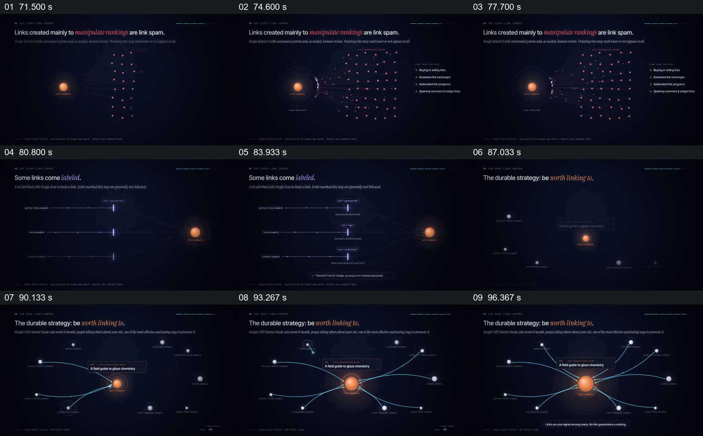

# 用三组连接方式对照风险、标记与自然获得

- 作品：案例 053，反向链接可视化解释（库内案例）。
- 原片范围：71.000–99.000 秒；[完整原片](../video.mp4)｜[本卡片段](c04.mp4)。范围含起点、不含终点。
- 观察方式：查看整片 64 帧和本卡九宫格；未独立连续原速观看或听审，动态、停顿、声音与同步仍未知。案例和政策作为片中内容记录，迁移未经实测。

## 原画面具体怎样设计

画面先在左侧放一颗橙色目标，右侧出现大量红色小点及通往目标的细线；目标周围有检测边界，旁边列出购买链接、过量交换等片中举例。接着画面换成三条分开的水平路径，沿途分别标注 sponsored、ugc、nofollow，三条虚线仍指向右侧同一目标，并有一句关于付费链接标注的提示。

约 87 秒，橙色目标再次回到画面中央，周围是不同来源节点，目标旁显示与陶艺有关的文章；后续更多蓝色曲线指向该目标，底部写明链接只是众多信号之一、不保证排名。目标延续了前面图中的视觉身份，但来源组织从密集同质点改为可区分的相关节点。

## 为什么这样设计，好在哪里

同一橙色目标贯穿三种图，帮助观众把注意力放在连接来源和标记如何改变，而不是每次重新认识主体。密集红点显示群体模式，分开排列的三条线让属性有独立阅读位置，最后相关来源与具体文章并置，把抽象建议落到可辨认对象。

片中政策、属性处理及排名提示只是原作的说明；实际规则需要查阅当前权威资料，不能因图形颜色而断言某个具体链接违规。

## 可直接使用的创意指令

当需要比较不同来源或不同属性的关系时，先固定同一个目标，再按类型分别展示来源群、带标记的连接和与目标有明确关系的来源；每种类型保留能够读清的标签和对象。可以用不同颜色帮助识别，但判断必须来自真实规则和具体条件。

视觉形式可替换，核心是同一目标、不同连接条件与相应结果之间的对应；涉及平台规则时标注来源和适用时间，不把示意网络当作真实检测记录。
