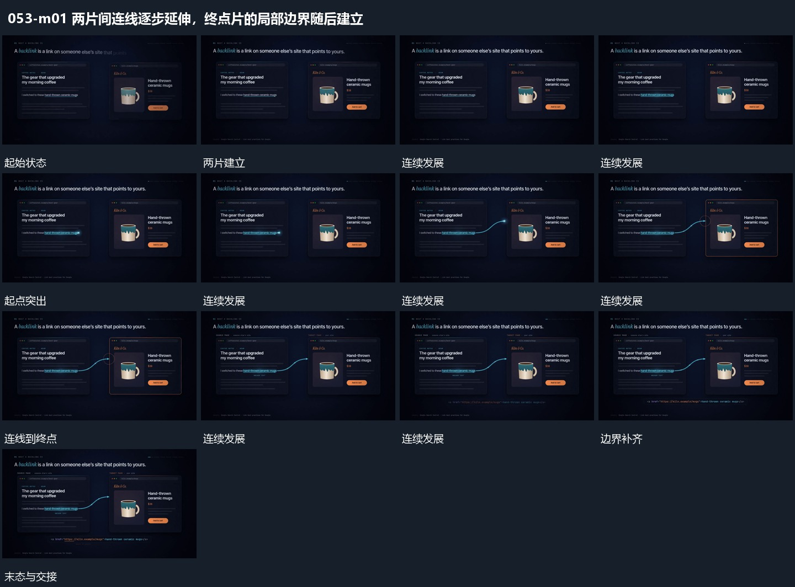

# 两片间连线逐步延伸，终点片的局部边界随后建立

## 运动指令

保留并置两片，从一片局部延伸曲线到另一片的局部。线到达后再为终点片补边界，起点保持局部强调，外围字组原位接替。

## 视频切片

[播放本机制的原片切片](m01.mp4)

保留起始准备、连续发展和完成或明确交接；首尾按本段运动范围裁切，不拼接、不变速。尾部只保留理解结果所需的展示。

## 分镜过程

## 组合与调整

线端应落在真实局部，边界不是随便给整片加的装饰。
