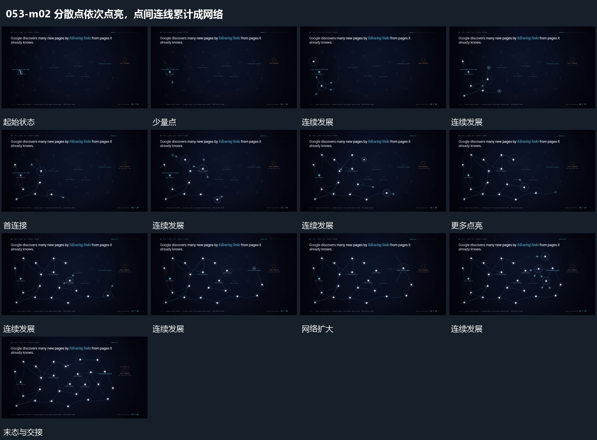

# 分散点依次点亮，点间连线累计成网络

## 运动指令

在分散点布局中先点亮局部点，再沿相邻点逐项增加连接线。新的点被接到网络后保持，连接从少到多扩展，未接入点继续留在后层。

## 视频切片

[播放本机制的原片切片](m02.mp4)

覆盖分镜中“少量点”至“完整网络”的连续过程，并保留邻近的前后衔接画面；原片中交叠发生的动作一并保留。

## 分镜过程

## 组合与调整

不要一次画完全部线。点数可减少，但增长路径应有明确起点。
